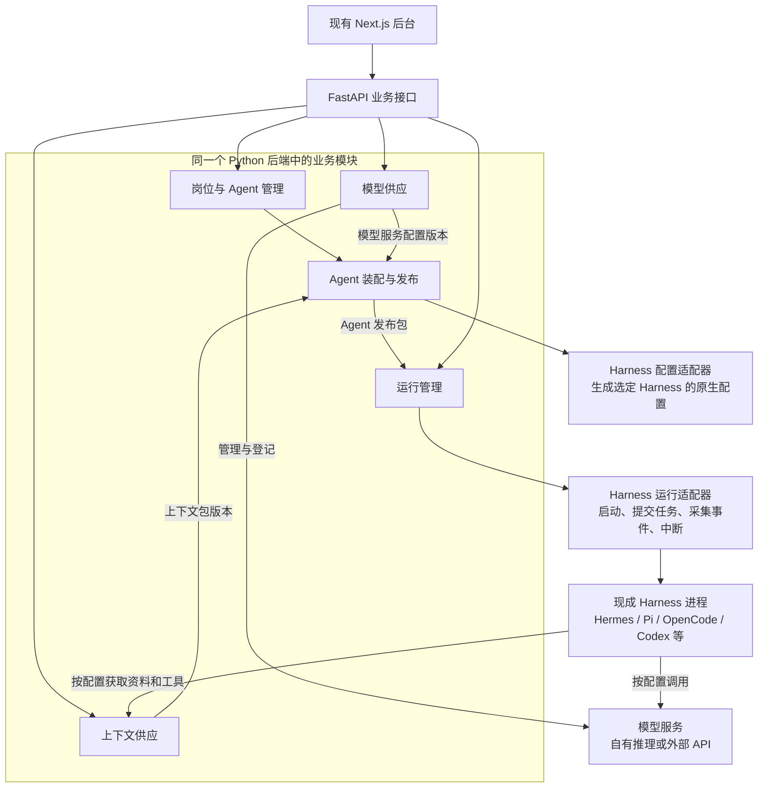
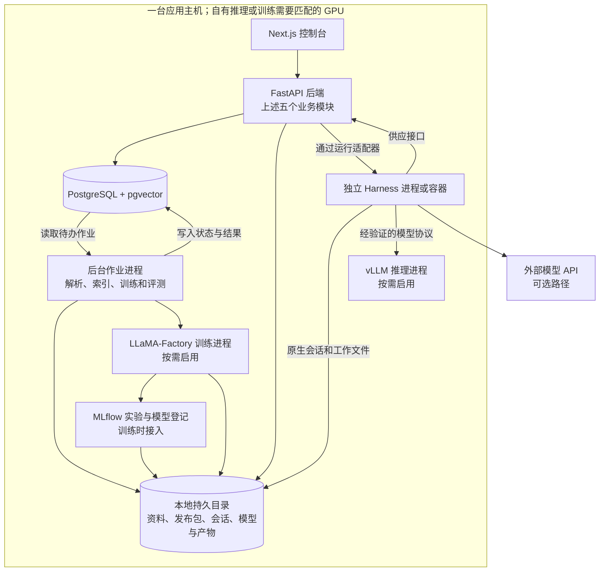

# 岗位 Agent 供应平台：单机架构方案

日期：2026-11-13。状态：单机方案及首版实施记录；作者明确先完成合理架构，不提前做 HA。

已实施：岗位与 Agent、固定发布包、原生 Pi 执行；上下文与岗位/模型记录统一存储，旧上下文自动迁移；资料文件导入；训练数据和模型产物登记；LLaMA-Factory LoRA 训练与合并导出；vLLM 本机部署与就绪后登记；统一供应作业、日志与停止。主导航、核心依赖、启动脚本和中文说明同步调整，原功能作为兼容工具保留。

尚未实现：自动来源同步、Docling/OCR、pgvector 检索索引、MLflow 实验服务接入、其他 Harness、原生会话续接和完整 CPT/DPO/评测迁移。以下相应段落属于目标方案；当前采用 pypdf/标准库解析文件，以平台数据表记录训练来源，并未宣称这些可选组件已部署。

[岗位 Agent 使用](../position-agents/README.md) · [供应流程与当前边界](../supply/README.md)。

## 1. 本轮确定的边界

平台以岗位 Agent 为管理对象，同时供应上下文、模型和 Agent。岗位 Agent 使用现成 Harness；执行循环、工具选择和上下文窗口管理交给 Harness。

首版是一套单机应用：一个管理后端、一个后台作业进程、按需要启动的 Harness 和模型进程。内部按业务职责分模块；模块分开不表示各部署一个服务。管理页面保持直接进入，不新增登录流程。

首版不引入集群调度、主备切换、跨主机接管和分布式会话恢复。配置和产物持久保存、版本明确、进程分开、任务有明确终态属于基础正确性，仍须具备。

## 2. 平台内部的模块与交付约定

| 模块 | 管什么 | 对外交付什么 | 不负责什么 |
| --- | --- | --- | --- |
| 岗位与 Agent 管理 | 岗位、岗位 Agent、负责人、默认发布版本 | Agent 标识与选用版本 | 不直接拼接上下文或调用模型 |
| 上下文供应 | 资料来源、规则、Skills、工具访问配置、检索范围 | 有版本的上下文包，以及按范围读取实时资料的接口 | 不决定 Agent 的执行步骤 |
| 模型供应 | 模型来源、数据集、训练作业、实验、可调用的模型服务和推理配置 | 模型服务配置版本：服务地址、协议、实际模型与调用参数 | 不为每个 Agent 复制或重训模型 |
| Agent 装配与发布 | Harness 选型、原生配置生成、上下文和模型依赖、验证结果 | 固定组合的 Agent 发布包 | 不承载 Harness 的执行循环 |
| 运行管理 | 运行、原生会话、工作目录、进程状态、事件和产物 | 任务结果、运行记录和实际使用的版本 | 不做首版跨主机调度 |

各模块通过服务接口调用，模块内部拥有自己的数据读写和规则；其他模块不能直接修改它的数据。可共用一个 PostgreSQL 实例和文件目录，通过表与路径划分归属。

### 模块关系图



这里把“配置适配”和“运行适配”分成两个职责：前者在发布前生成配置文件、Skills 和工具连接；后者对接进程或原生协议。二者可以放在同一个 Harness 插件包里，平台不会把各种 Harness 的配置格式当成相同格式。

## 3. 三种供应如何连接

### 上下文供应的交付物

一个上下文包包含：岗位职责、规则和 Skills 的固定版本，静态资料或索引版本，工具及实时数据读取配置，适用范围，以及这些内容的来源。共用内容统一维护，每个 Agent 选择自己的引用。

上下文供应模块负责两种读取：启动前生成所需说明文件和配置；运行中通过 MCP、HTTP 或该 Harness 支持的工具扩展读取内容。订单状态等实时事实固定读取方式和范围，实际值在读取时取得，并记录来源与时间。

文档处理采用 Docling；切分、embedding 调用、来源同步和授权过滤是平台代码。检索先采用 PostgreSQL 全文检索和 pgvector，已有图谱通过业务接口接入。一个静态索引版本同时记录原文、切分规则、embedding 模型和索引位置，旧版本不会因更新索引而悄悄改变。

### 模型供应的交付物

模型供应交付可调用的模型服务配置，而不只是一个模型文件。配置包含协议、服务地址、模型或部署修订、支持的能力、推理参数和凭证引用。

```text
已有模型或外部 API → 验证调用与所需能力 → 登记模型服务配置版本
训练数据 → LLaMA-Factory → 训练/评测记录与模型版本 → 部署并检查就绪
                                               → 登记模型服务配置版本
```

模型实验和登记可采用 MLflow，自有推理采用 vLLM。MLflow 登记与模型服务上线是两个动作，由模型供应模块负责关联。训练与推理使用独立软件环境或进程，GPU 不足时明确排队或错峰。

LiteLLM 在需要统一管理多个服务商或模型路由时接入，不作为首版所有 Harness 的必经组件。模型协议、工具调用和流式输出必须与所选 Harness 实测兼容；接入网关时也要验证这个组合。外部模型不提供固定版本时，记录这一限制。

### Agent 供应的交付物

Agent 装配模块把 Harness 原生配置、上下文包版本和模型服务配置组合为一个候选包，交给运行管理试跑岗位任务；验证通过后，将同一份候选包标记为可用发布版本，不重新生成另一份配置。

发布包记录：岗位 Agent 标识、Harness 类型和版本、适配器版本、原生配置文件摘要、上下文包版本、模型服务配置版本、环境要求和凭证引用。发布后不可原地修改，变更产生新版本。

平台保存发布包和依赖关系；运行管理加载该发布包。已开始的会话使用原组合，后续任务可选择新版本。删除或停用被 Agent 使用的上下文包、模型服务之前，供应模块需检查引用并明确处理，不能留下无法运行的 Agent。

## 4. 主要数据及归属

| 对象 | 含义 | 所属模块 |
| --- | --- | --- |
| Position、Agent | 岗位及其 Agent 定义 | 岗位与 Agent 管理 |
| ContextResourceVersion、ContextPackageVersion | 资料/规则版本，以及岗位选用的组合 | 上下文供应 |
| DatasetVersion、ModelArtifact、ModelServiceRevision | 数据集、模型产物与真正可调用的服务修订 | 模型供应；实验详情引用 MLflow |
| HarnessProfileVersion | 某种 Harness 的版本与原生配置模板 | Agent 装配与发布 |
| AgentRelease | 一份已验证的 Harness、上下文、模型组合 | Agent 装配与发布 |
| Run、Session、ArtifactRef | 一次运行、对应的原生会话与产物引用 | 运行管理 |
| Job | 解析、索引、训练或评测等后台作业 | 发起作业的模块 |

核心关联如下：

```text
岗位 → 岗位 Agent → Agent 发布版本
                         ├─ Harness 配置版本
                         ├─ 上下文包版本
                         └─ 模型服务配置版本
运行 → 确定的 Agent 发布版本 → 原生会话、事件与产物
```

数据库中的 Agent 配置版本不替代 Harness 的原生会话文件。原生会话与私有记忆存入对应实例的持久目录；平台保存标识与文件引用。同一个会话的后续请求仍由该目录与 Harness 版本处理，首版不跨机器搬迁会话。

## 5. 单机部署图与开源工具



- 沿用 Next.js；Python 后端采用 FastAPI，MCP 供应采用 FastMCP。
- PostgreSQL 保存业务记录并支持 pgvector 检索；大文件与原生状态先用本地持久目录，文件访问集中经过存储接口，保留以后接 S3 的替换位置。
- 一个后台作业进程读取数据库中的待办作业，按明确的状态执行。首版不依赖 RabbitMQ、Celery、分布式锁或跨主机执行租约。
- Harness 运行与长训练使用独立进程；后台作业等待训练时不占用 Web 请求，Harness 运行也不依赖资料处理作业先完成。
- Docker Compose 可用于固定启动数据库、管理服务和按需模型服务；进程管理保持本机范围。适配器不得把普通请求中的任意命令直接交给进程启动器。
- 不在首版引入 SeaweedFS 或集群对象存储；有实际跨机器共享或容量需要时，再实现已有存储接口的远端后端。

不把模型权重、软件包或镜像的大小当成已经确定的资源需求；选定首个 Harness、模型及岗位任务后，按实际内存和显存安排进程。

## 6. Harness 接入原则

先用一个 Harness 完成完整岗位流程，再接第二个验证边界。平台支持选择 Harness，但不声明所有 Harness 拥有相同能力。

| Harness | 已核对的依据 | 首版接入时需确定 |
| --- | --- | --- |
| Pi | 原生 RPC 子进程与 SDK | 选定版本、模型连接与所需工具扩展 |
| Hermes | 原生模型配置、上下文、Skills、MCP 与记忆 | 独立配置目录、任务提交和事件采集方式 |
| OpenCode | 已核对 V1 HTTP/SDK；当前配置文档另有变化 | 明确主版本，不能混用不同版本的协议 |
| Codex | App Server 双向 JSON-RPC | 选定版本，以原生会话、事件和确认机制接入 |
| Claude Code | 非交互 CLI 和官方 Agent SDK | 可选接入，使用条件独立核验 |
| 用户提到的 DeepSeek 相关 Harness | 项目与发行版本尚未明确 | 取得准确仓库后核对，暂不声称已兼容 |

配置适配器负责：生成说明文件、Skills、工具/MCP 配置和模型连接配置，并检查支持情况。运行适配器负责：启动或连接、提交任务、读取事件、中断和保存原生状态。循环中的推理、工具选择和上下文压缩交给 Harness。

Harness 的 HOME、配置目录和工作目录按实例明确分配，避免继承宿主机或其他岗位的配置。共用资料的读取授权仍由供应接口检查；主密钥不写入发布包。权限设置不等同于操作系统隔离，运行环境的文件与网络范围在首次接入时一起验收。

## 7. 首版需要保证的正确性

- 运行创建使用请求标识去重；先保存运行记录，再启动对应进程，进程信息与原生会话标识回写记录。
- 同一个原生会话不由多个写入者同时操作；中断请求与实际停止分别记录。
- 后台或主机重启后核对本机已有进程与原生状态；无法确认的任务标为待核对，不自动重复执行外部动作。
- 记录每次运行使用的 Agent 发布版本、实际模型服务及读取的资料版本/时间。
- 变更资料或模型形成新版本；历史 Agent 使用的服务在停用前检查引用。实时权限撤销仍对新请求生效，不因固定版本而永久保留旧授权。
- 上下文原文、索引和元数据属于同一个构建结果，完整准备好后才允许发布引用。
- 评测检查 Agent 的整套组合，并分别保留模型评测与上下文检索检查，避免只测模型就宣称岗位 Agent 可用。

这些规则用于避免普通单机使用中的重复执行、串配置和结果不可追溯，不以首版实现自动容灾为前提。

## 8. 直接复用与平台开发

直接复用：现成 Harness、Docling、FastMCP、PostgreSQL/pgvector，以及按需要启用的 LLaMA-Factory、MLflow 和 vLLM。

平台开发：上述五个业务模块、上下文来源连接与供给规则、Harness 配置/运行适配器、候选包验证和发布关系、模型部署连接代码、单机作业及运行记录。

现有索引、图谱、训练与评测代码按这些模块的业务接口接入，旧 Gradio 兼容层作为迁移期适配器保留。模块和页面不必一一对应，现有页面数量不决定后台职责划分。

## 9. 实施顺序

1. 建立岗位 Agent、上下文包、模型服务、Harness 配置与 Agent 发布版本之间的关系，并把接口和数据归属定清楚。
2. 选定一种 Harness，生成一份真实岗位配置，接入一份预配置的上下文与一个可调用模型，完成任务并保存原生会话与产物。
3. 将现有资料处理、训练、推理和评测接入所属模块，验证上下文更新、模型更新和 Agent 新版本发布。
4. 用第二种 Harness 验证哪些配置可以共用、哪些需要专门适配；根据真实任务结果调整边界。

## 10. 来源与历史

以下资料用于核对已有组件接口，平台模块与交付约定属于本项目方案：

- [Pi RPC](https://raw.githubusercontent.com/earendil-works/pi/main/packages/coding-agent/docs/rpc.md)
- [Hermes 配置](https://hermes-agent.nousresearch.com/docs/user-guide/configuration)
- [OpenCode V1 Server](https://opencode.ai/v1/docs/server/) 与 [当前配置](https://opencode.ai/docs/config/)
- [Codex App Server：OpenAI Docs](https://learn.chatgpt.com/docs/app-server)
- [Claude Code 非交互运行](https://code.claude.com/docs/en/headless)
- [Docling](https://github.com/docling-project/docling)、[pgvector](https://github.com/pgvector/pgvector)
- [LLaMA-Factory](https://github.com/hiyouga/LlamaFactory)、[MLflow](https://mlflow.org/docs/latest/ml/model-registry/)、[vLLM](https://docs.vllm.ai/en/latest/serving/online_serving/)

[最初方案及运行层审查](history/initial/README.md)保留作讨论记录；[当前架构审查](review/README.md)用于登记本轮设计判断。
