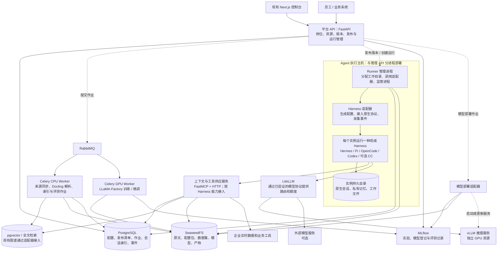

# 岗位 Agent 供应平台：架构重设计

日期：2026-11-13。状态：设计稿，尚未实施；当前运行代码基线为 `6b52b65`。本文中的组件、接口与数据表均为目标设计，不代表现有平台已经具备这些能力。

## 1. 已明确的要求

- 每个岗位可以设置自己的 Agent，并提前配置工作所需的上下文。
- Agent 由 Harness 与 Model 共同组成；平台同时承担上下文供应、模型供应和 Agent 供应。
- 使用 Hermes、OpenCode、Codex、Claude Code、Pi 等现成 Harness；不采用 LangGraph，不自行重写模型与工具的执行循环。
- 资料和规则可以共用，每个岗位仍有自己的配置与访问范围。
- 保留企业上下文供应生产后台定位；测试床是验证能力。
- 控制台保持直接进入的方式，不新增浏览器凭证登录步骤；远程页面访问由部署侧统一处理。

## 2. 首要架构决定

平台管理岗位、发布版本、资源及其关联。实际的模型调用、工具调用顺序、上下文窗口处理和会话执行由所选 Harness 实现。

平台通过适配器生成 Harness 原生配置，准备工作目录，连接模型与上下文服务，再启动或连接 Harness。适配器负责进程和协议接入，不判断 Agent 下一步该做什么。

将三种对象分开保存：

1. **岗位 Agent**：长期身份，例如“采购审核助理”，关联岗位、负责人和当前发布版本。
2. **Agent 发布版本**：不可原地修改的组合清单，固定 Harness 类型与版本、配置、上下文绑定、模型服务配置和环境镜像摘要。
3. **运行实例与会话**：某次实际运行所在的进程或容器、原生会话标识、工作目录、状态和产物。

更新发布版本只影响后续按该版本创建的运行。已开始的会话继续使用原组合；不同 Harness 之间不迁移正在进行的会话。

## 3. 系统组件与部署边界

实线是请求、协议通信或数据读写；虚线是作业提交、配置分发与部署。



管理 API 与上下文供应可先放在同一个 Python 应用中，边界通过模块和接口保持清楚。Runner、资料处理、训练和推理独立运行；API 不加载训练框架或模型权重。RabbitMQ 分开设置资料、训练、评测和部署队列，避免长训练占住其他作业。

## 4. 上下文如何供应

### 4.1 提前准备的内容

岗位职责、工作规则、Skills、静态资料快照、工具说明和访问范围，组成有版本的上下文配置。原文及配置包放对象存储，来源、版本、摘要和授权放 PostgreSQL，检索内容放 pgvector 或已有索引服务。

资料同步和解析作为后台作业执行。新索引完整建立后再切换可用版本；失败的构建不覆盖已发布版本。企业来源连接器、切分策略、embedding 调用与授权过滤需要平台实现，Docling 负责文档解析。

### 4.2 配置到 Harness 的方式

适配器按目标 Harness 支持的机制生成原生说明文件、Skills、工具配置和模型配置，不把同一份通用 JSON 直接交给所有 Harness。

- 启动必需的职责、规则和配置引用在启动前准备好。
- 大量资料通过有权限检查的检索、读取接口按需供应。
- 订单状态等实时信息记录读取方式、授权和新鲜度要求，运行时读取，并记录实际读取时间和来源。
- 支持 MCP 的 Harness 连接 MCP；其他 Harness 使用经过验证的原生工具扩展或文件读取方式，不声明全部原生支持 MCP。

“提前配置好”表示资料范围、规则、工具和模型连接已经确定，不表示把所有企业数据提前放入模型窗口。

### 4.3 原生记忆与企业共享资料

Harness 自身的会话和学习记忆保存在其独立持久目录，平台记录归属及备份信息。产生的经验可以作为候选资料提交到平台；正式纳入共用上下文后才形成新版本。Agent 的私有记忆与其他岗位的资料不会因共用 Harness 而自动混合。

## 5. 模型如何供应

模型供应包含两条路径：

```text
自有模型：数据集版本 → 训练/微调作业 → 评测 → MLflow 模型版本
                                      → 部署适配器 → vLLM 服务
外部模型：服务商及协议配置 → 能力验证 → 登记可用模型服务
两条路径：可用模型服务 → LiteLLM 中的已验证路由 → Harness 原生模型配置
```

MLflow 管训练记录、评测和模型登记；平台管哪个岗位 Agent 引用了哪个模型服务。SeaweedFS 保存权重和 adapter 等大文件。模型部署适配器负责读取登记信息、处理推理格式、分配资源、启动服务和检查就绪；MLflow 的“已登记”不表示服务已经上线。

训练和推理分别分配 GPU 资源；只有一组资源时按明确计划错峰，不能承诺同时承载两种负载。外部模型不经过本地训练与 vLLM。

Harness、模型和协议必须作为组合验证：包括工具调用、流式输出、上下文长度及所需能力。OpenAI 风格接口、Responses、Anthropic Messages 等协议不能视为完全等价。未经验证的组合不能发布为可用；不支持网关的 Harness 接入方式保留为受控的供应商直连，并明确其额度和审计覆盖范围。

发布记录固定模型服务修订与网关配置修订，运行记录保存实际模型标识和实际路由。外部供应商不提供不可变版本时，标记为供应商可变，不声称完全可复现。工具动作或模型调用开始后，不因网关错误盲目重跑整次任务。

## 6. Agent 如何供应

### 6.1 发布内容

一个发布清单包含：岗位 Agent 标识、Harness 类型和精确版本、镜像或软件包摘要、适配器版本、原生配置包摘要、上下文配置版本及实时读取规则、模型服务修订、工具授权、资源限制和工作目录策略。

这些内容组成可检查的发布包；凭证仅保存引用，部署时注入受限凭证。服务端主密钥不放入上下文、配置包或镜像。

### 6.2 发布与运行流程

```text
编辑岗位配置
  → 核对 Harness/模型/工具能力组合
  → 生成原生配置包并保存摘要
  → 用岗位测试任务验证
  → 创建不可变 Agent 发布版本
  → Runner 准备独立工作目录并启动 Harness
  → 通过原生协议提交任务、接收事件和结果
  → 保存事件、实际资源版本及产物
```

Runner 负责资源和生命周期，Harness 负责执行循环。一个岗位可以运行多个会话；每个会话关联确定的发布版本和原生会话标识。具有个人记忆或会话隔离要求的使用者分配独立 profile；不能让多个用户不加区分地写入同一个 Harness home 目录。

平台内的事件统一表示运行开始、消息、工具活动、等待确认、产物和终态，同时保留原生事件引用。平台不要求各 Harness 暴露相同的内部推理过程。

### 6.3 适配器接口

以下为平台拟定接口，不是声称上游已有统一 API：

```text
capabilities(harness_version)                → 能力与版本范围
prepare(release, workspace, credential_refs) → 原生配置与校验结果
launch(prepared_runtime)                     → runtime_handle
submit(runtime_handle, native_session, task) → submission_id
events(runtime_handle, cursor)              → 标准事件 + 原生事件引用
interrupt(runtime_handle, native_session)   → 接收状态 / 实际终态
resume(native_state, same_release)          → 恢复结果 / 明确不支持
collect(runtime_handle)                     → 产物与原生状态引用
```

中断、恢复、审批、模型自定义、工具扩展分别列能力清单；不支持的能力明确返回不支持。平台的“请求已接收”不等于任务完成，也不等于操作已经停止。

### 6.4 Harness 接入证据与状态

| Harness | 已核对的原生接入方式 | 本平台的计划与边界 |
| --- | --- | --- |
| Pi | RPC 子进程与 SDK；RPC 使用 stdin/stdout JSONL | 适合作为首个协议验证候选；MCP 或其他工具按扩展机制核实，不宣称原生通用支持 |
| Hermes | 原生模型配置、上下文文件、Skills、MCP 与持久记忆 | 通过独立 profile 和原生进程接入；具体无界面控制协议与事件接口按选定版本再验证 |
| OpenCode | 已核对 V1 HTTP Server 与 SDK 文档；当前配置文档已变化 | 适配器必须锁定主要版本，不能把 V1 API 自动套到新版 |
| Codex | App Server 双向 JSON-RPC；SDK 和非交互执行另有入口 | 交互服务优先核对 App Server 的 stdio 接入，保留原生会话与确认机制 |
| Claude Code | 非交互 CLI 与官方 Agent SDK | 可选接入，使用条件单独核验；不作为纯开源部署的必需组件 |
| 用户提到的 DeepSeek 相关 Harness | 尚未确定具体仓库及发行版本 | 预留适配器位置，待对应项目核实后纳入兼容清单 |

本表表示文档核验情况，尚未实现上述适配器。首版先完成一种 Harness 的全链路，再用第二种验证平台边界；不能仅靠画出多个名称就宣称全部兼容。

## 7. 数据归属与接口

| 数据 | 权威保存位置 | 其他组件的职责 |
| --- | --- | --- |
| 岗位、Agent、Harness 配置、发布版本 | 平台 PostgreSQL | 控制台通过 API 编辑，Runner 按发布清单加载 |
| 企业事实 | 企业源系统；发布的快照和索引另行版本化 | 上下文服务记录来源、读取时间和快照，不冒充原始事实系统 |
| 模型实验与登记版本 | MLflow | 平台保存引用，模型部署适配器登记实际部署修订 |
| 权重、资料、数据集、配置包、产物 | SeaweedFS | 数据库保存对象地址、摘要、归属和保留策略 |
| Harness 原生会话与记忆 | 独立实例持久目录及其受保护备份 | 平台保存会话索引、标准事件和原生文件引用 |
| 作业和运行状态 | 平台 PostgreSQL | RabbitMQ 负责投递，不作为唯一任务记录 |

业务 API 使用 Agent、发布版本、模型服务和运行标识，不再以 Gradio 组件编号作为长期契约。拟定入口包括 `POST /agents/{id}/releases`、`POST /agents/{id}/runs`、`GET /runs/{id}/events`、`POST /runs/{id}/interrupt`、`POST /model-deployments`。上线条件及授权由服务端验证。

## 8. 作业、故障和恢复

- 创建作业与待发送消息在同一数据库事务保存，由发送进程投递 RabbitMQ，避免作业已创建但消息丢失。
- Worker 领取作业时检查作业标识、执行归属及心跳；重复投递不能自动启动第二个 Harness 实例或第二次训练。
- 可安全重复的资料处理使用幂等写入；涉及外部动作的任务中断后先核对原生状态，不承诺“恰好执行一次”。
- Runner 崩溃后先核对已有进程、原生会话和持久目录；只有同一发布版本且 Harness 支持恢复时才继续。平台事件日志本身不能替代 Harness 原生恢复状态。
- API 重启不把其他执行进程仍在运行的全部任务统一改为中断。
- 模型更新先建立新部署并检查就绪，再更新后续运行使用的服务修订；保留明确可用的回退版本及其资源条件。
- 上下文源不可用时，按预设规则选择已发布快照或报错，并在结果中标明数据时间。

## 9. 开源基础设施与部署

首版采用单企业部署，管理与运行分进程；Docker Compose 管理每台机器上的固定服务，跨主机地址和 Worker 队列显式配置，不宣称 Compose 提供集群调度或高可用。

- 管理主机：现有 Next.js、FastAPI、PostgreSQL/pgvector、RabbitMQ、SeaweedFS、LiteLLM、MLflow。
- Agent 执行主机：Runner、各 Harness 的独立镜像或软件环境、原生会话持久卷。
- 资料处理主机：Celery CPU Worker 与 Docling，可与管理主机合并部署。
- GPU 主机：训练 Worker 与 vLLM，按 GPU 资源划分队列和服务；模型与硬件兼容性在实际选型时验证。

首个开源运行候选为 Pi、Hermes 或 Codex；Claude Code 属于可选接入，模型访问费用及条件与基础设施开源分开处理。

基础设施接入现有企业身份与网关；上下文、模型、工具使用运行级受限权限。Runner 的容器管理权限不交给浏览器或普通 API 请求，执行目录也不挂载宿主机的管理凭证。观测先统一运行标识、原生会话标识、模型调用标识和资源引用；MLflow 接收训练与评测记录，Harness 事件通过适配器采集，不预设全部能自动接入相同 tracing SDK。

## 10. 需要开发与复用的内容

直接采用：现成 Harness、Docling、pgvector、FastMCP、LLaMA-Factory、MLflow、vLLM、LiteLLM、Celery、RabbitMQ、SeaweedFS。

平台开发：岗位 Agent 与发布管理、Harness 适配器、原生配置生成、Runner、企业来源连接器与授权读取、模型部署适配器、版本与运行关联、作业可靠投递和事件归一化。

现有检索、图谱、模型处理和评测代码按业务接口逐步接入；Gradio 兼容层可作为迁移期执行适配器保留。页面按岗位管理工作需要调整，现有模块数量不作为目标架构的约束。

## 11. 实施顺序与验收

1. **岗位与发布对象**：建立岗位 Agent、Harness 配置、上下文配置、模型服务和不可变发布关系；旧数据可追溯迁移。
2. **一条真实运行链**：选定一种 Harness 及精确版本，实际加载岗位配置，通过平台读取一份上下文、调用一个模型服务、执行受控工具、返回产物。
3. **运行生命周期**：验证并发隔离、流式事件、原生会话保留、中断及重启后的正确状态，明确不可恢复的情形。
4. **完整模型供应链**：用一个合适规模的模型验证训练或微调、登记、部署、调用和回退，明确权重/adapter 的兼容格式。
5. **第二种 Harness**：同一岗位定义由另一个适配器生成相应配置，用同一岗位测试任务验证可接入；不要求输出相同或原生会话互通。
6. **生产验收**：按实际并发、数据规模和可用性目标完成容量、备份恢复、资源隔离和故障测试，再决定是否需要集群部署。

## 12. 来源

以下官方资料于 2026-11-13 核对；它们支持组件能力描述，本文的平台划分和接口是本项目设计。

- [Pi 原生 RPC](https://raw.githubusercontent.com/earendil-works/pi/main/packages/coding-agent/docs/rpc.md)：子进程 JSONL、事件与终态区分。
- [Hermes 文档](https://hermes-agent.nousresearch.com/docs)：配置、上下文、Skills、MCP 与持久记忆；[配置说明](https://hermes-agent.nousresearch.com/docs/user-guide/configuration)。
- [OpenCode V1 Server](https://opencode.ai/v1/docs/server/) 与 [当前配置文档](https://opencode.ai/docs/config/)：分别作为版本化接口和配置证据。
- [Codex App Server：OpenAI Docs](https://learn.chatgpt.com/docs/app-server)：原生会话、双向 JSON-RPC、事件及确认机制；[开放 Harness 与接入方式](https://developers.openai.com/blog/codex-as-a-platform)。
- [Claude Code 程序化运行](https://code.claude.com/docs/en/headless)：非交互 CLI 与 Agent SDK。
- [Docling](https://github.com/docling-project/docling) 与 [pgvector](https://github.com/pgvector/pgvector)：文档处理及向量检索基础能力。
- [LLaMA-Factory](https://github.com/hiyouga/LlamaFactory)：训练、微调及实验记录接入。
- [MLflow 模型登记](https://mlflow.org/docs/latest/ml/model-registry/)：实验与模型版本关系。
- [vLLM 在线服务](https://docs.vllm.ai/en/latest/serving/online_serving/) 与 [LiteLLM](https://docs.litellm.ai/docs/proxy/quick_start)：推理及模型路由。
- [Celery](https://docs.celeryq.dev/en/stable/getting-started/introduction.html)：通过 broker 分发到工作进程。
- [SeaweedFS](https://github.com/seaweedfs/seaweedfs)：S3 兼容对象存储。
