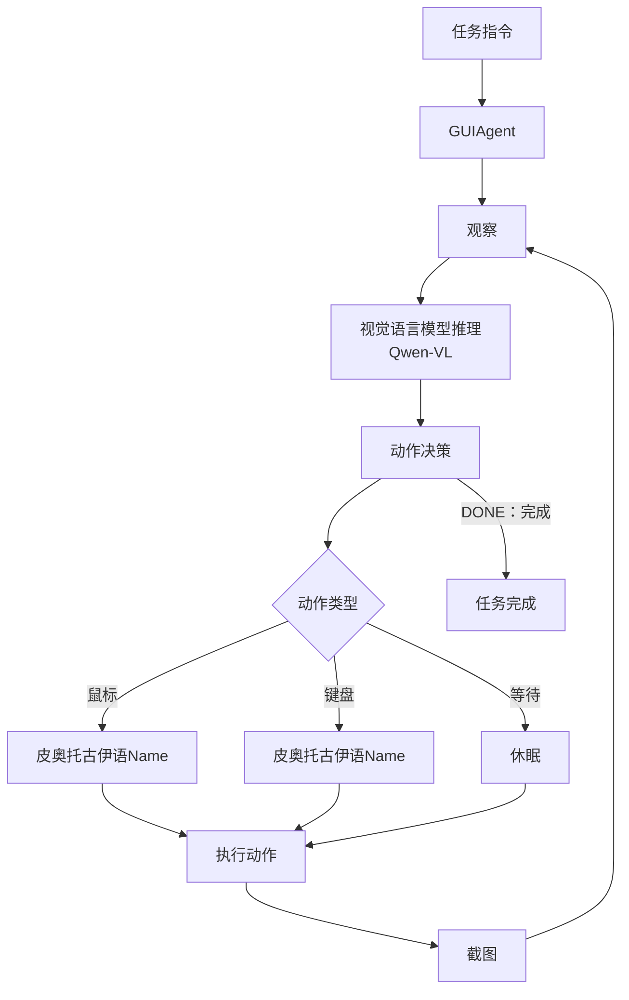

# 桌面智能体的观察与执行

[项目说明](../../../../README.md) · [当前模块说明](../../README.md)

桌面任务由环境采集截图，模型根据任务和观察生成响应，解析器再得到动作，环境执行后返回新观察。环境、模型、动作解析和任务结束判断都可能独立失败。

当前实现分为 `SimpleDesktopEnv`、`SimplePromptAgent` 和 `GUIAgentService`。模型未配置时存在返回 WAIT 的模拟响应，不能将这种响应当作真实视觉推理成功。

## 怎样验证

1. 核对所选环境与截图来源，先确认观察可用。
2. 检查模型完整响应和解析后的动作是否一致。
3. 查看每步执行结果、截图、轨迹以及最终任务状态。

## 使用边界

服务返回的外层 status 表示调用是否成功，实际任务结果还要看 results.final_status；达到最大步数不等于任务完成。

## 实现入口

- [src/search_engine/gui_agent_service.py](../../../../src/search_engine/gui_agent_service.py)
- [src/search_engine/image_tab/image_tab.py](../../../../src/search_engine/image_tab/image_tab.py)

## 代码与图解参考

下列内容保留原有讲义中的代码、图解和输入输出示例。它们用于理解设计，可能省略初始化、依赖或使用旧接口；当前调用方式以本页“实现入口”链接的源码为准。示例中的指标、耗时和结果不作为本项目的验收数据。

<details>
<summary>展开代码与图解示例</summary>

### 示例 1



### 示例 2

```python
while not task_complete:
    # 1. Observe
    screenshot = capture_screen()

    # 2. Reason
    action = vlm.decide_action(screenshot, task, history)

    # 3. Act
    execute_action(action)

    # 4. Check completion
    if action['type'] == 'DONE':
        break
```

</details>
