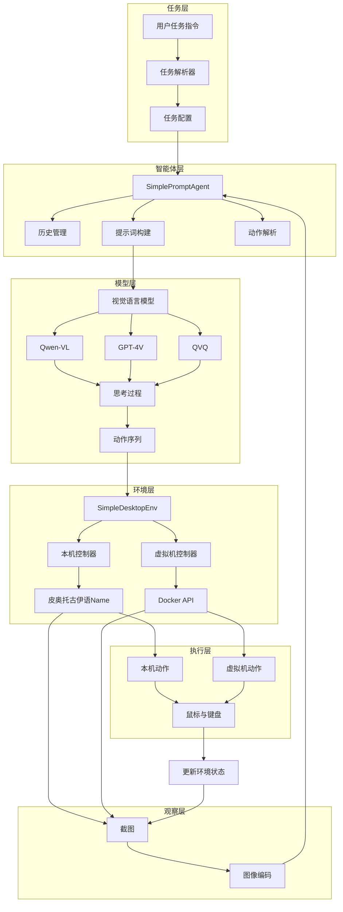

# 桌面智能体阅读路径

[项目说明](../../../../README.md) · [当前模块说明](../../README.md)

该模块的安装和当前操作步骤统一维护在模块 README，本页用于连接原讲义中的图解和代码。先读模块主说明，完成一次最小操作，再按具体问题进入专题，避免在多份总览中重复维护参数与启动命令。

## 怎样验证

1. 确认输入材料、所选模型或服务已经就绪。
2. 执行一个能观察到实际结果的小任务，保留输入和输出。
3. 对照真实源码与运行结果判断能力，不使用概念图中的组件推断已部署功能。

## 使用边界

下面的原有示例可能包含旧版路径、模拟输出或未实现的扩展设计；当前操作只以模块 README 和源码为准。

## 实现入口

- [src/search_engine/gui_agent_service.py](../../../../src/search_engine/gui_agent_service.py)
- [src/search_engine/image_tab/image_tab.py](../../../../src/search_engine/image_tab/image_tab.py)

## 代码与图解参考

下列内容保留原有讲义中的代码、图解和输入输出示例。它们用于理解设计，可能省略初始化、依赖或使用旧接口；当前调用方式以本页“实现入口”链接的源码为准。示例中的指标、耗时和结果不作为本项目的验收数据。

展开代码与图解示例

### 示例 1

