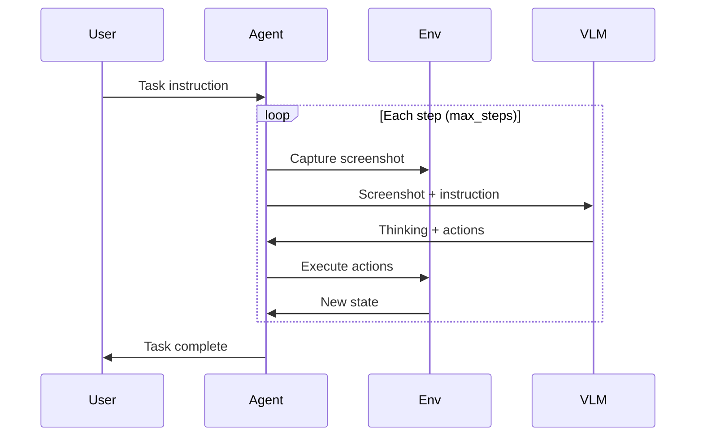

# 任务执行、终态与停止

[项目说明](../../../../README.md) · [当前模块说明](../../README.md)

`GUIAgentService.run_task` 逐步组织模型预测、动作执行与新观察，并记录轨迹。任务可能正常结束、失败、达到最大步数或被停止，必须分开解释。

当前返回的外层 status 为 success 时，仍应继续查看 results.final_status、步数和最终画面。外层成功只说明服务流程返回了结果。

## 怎样验证

1. 用明确可观察的目标开始，例如打开一个指定窗口。
2. 检查每一步的截图、动作和错误信息。
3. 在终态核对实际画面，并测试停止入口能否结束任务。

## 使用边界

未配置模型时可能只获得模拟 WAIT 动作。达到步数上限或模型输出 DONE 都需要结合实际任务状态判断，不能自动记录为业务成功。

## 实现入口

- [src/search_engine/gui_agent_service.py](../../../../src/search_engine/gui_agent_service.py)
- [src/search_engine/image_tab/image_tab.py](../../../../src/search_engine/image_tab/image_tab.py)

## 代码与图解参考

下列内容保留原有讲义中的代码、图解和输入输出示例。它们用于理解设计，可能省略初始化、依赖或使用旧接口；当前调用方式以本页“实现入口”链接的源码为准。示例中的指标、耗时和结果不作为本项目的验收数据。

<details>
<summary>展开代码与图解示例</summary>

### 示例 1



### 示例 2

```
“打开浏览器并搜索 Python”
“创建一个名为 test 的文件夹”
“打开终端并输入 ls”
```

### 示例 3

```
“打开浏览器，访问 google.com，搜索‘Python 教程’，
然后打开第一条结果”
```

### 示例 4

```python
TASK_CONFIG = {
    "max_steps": 15,           # Maximum steps
    "step_delay": 1.5,         # Delay between steps (seconds)
    "enable_thinking": True,   # Show VLM thinking process
    "use_trajectory": True     # Use history context
}
```

</details>
