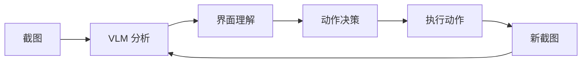

# 视觉语言模型的配置与输入

[项目说明](../../../../README.md) · [当前模块说明](../../README.md)

视觉语言模型需要任务描述、截图和可选历史共同形成输入。模型名、端点与密钥必须配套，不能只填写一个模型名称就认为已接通。

`SimplePromptAgent` 负责客户端、截图编码、消息构造和动作解析；图片页还提供将截图与任务发送给模型的交互入口。

## 怎样验证

1. 确认端点、模型与密钥来源，先检查一次完整请求是否成功。
2. 检查截图编码及尺寸是否与实际画面相符。
3. 同时查看原始响应和解析后的动作，避免把格式错误当成执行成功。

## 使用边界

并非所有兼容端点或模型都支持相同的视觉输入与动作格式。API 未配置时的模拟响应只能用于观察界面流程。

## 实现入口

- [src/search_engine/gui_agent_service.py](../../../../src/search_engine/gui_agent_service.py)
- [src/search_engine/image_tab/image_tab.py](../../../../src/search_engine/image_tab/image_tab.py)

## 代码与图解参考

下列内容保留原有讲义中的代码、图解和输入输出示例。它们用于理解设计，可能省略初始化、依赖或使用旧接口；当前调用方式以本页“实现入口”链接的源码为准。示例中的指标、耗时和结果不作为本项目的验收数据。

<details>
<summary>展开代码与图解示例</summary>

### 示例 1



### 示例 2

```bash
export DASHSCOPE_API_KEY="your_key_here"
```

### 示例 3

```bash
export OPENAI_API_KEY="your_key_here"
```

### 示例 4

```python
VLM_CONFIG = {
    "qwen": {
        "api_key": os.getenv("DASHSCOPE_API_KEY"),
        "base_url": "https://dashscope.aliyuncs.com/compatible-mode/v1",
        "model": "qwen3-vl-plus",
        "enable_thinking": True
    },
    "openai": {
        "api_key": os.getenv("OPENAI_API_KEY"),
        "base_url": "https://api.openai.com/v1",
        "model": "gpt-4o"
    }
}
```

### 示例 5

```text
你是 GUI 自动化代理。请根据截图和任务目标给出下一步动作。

任务：{user_instruction}
当前界面：{screenshot_context}
历史动作：{action_history}

可用动作：
- pyautogui.click(x, y)
- pyautogui.typewrite(text)
- pyautogui.press("key")
- pyautogui.scroll(amount)
- WAIT / DONE / FAIL

请按如下格式输出：
Action: ...
Reasoning: ...
```

</details>
