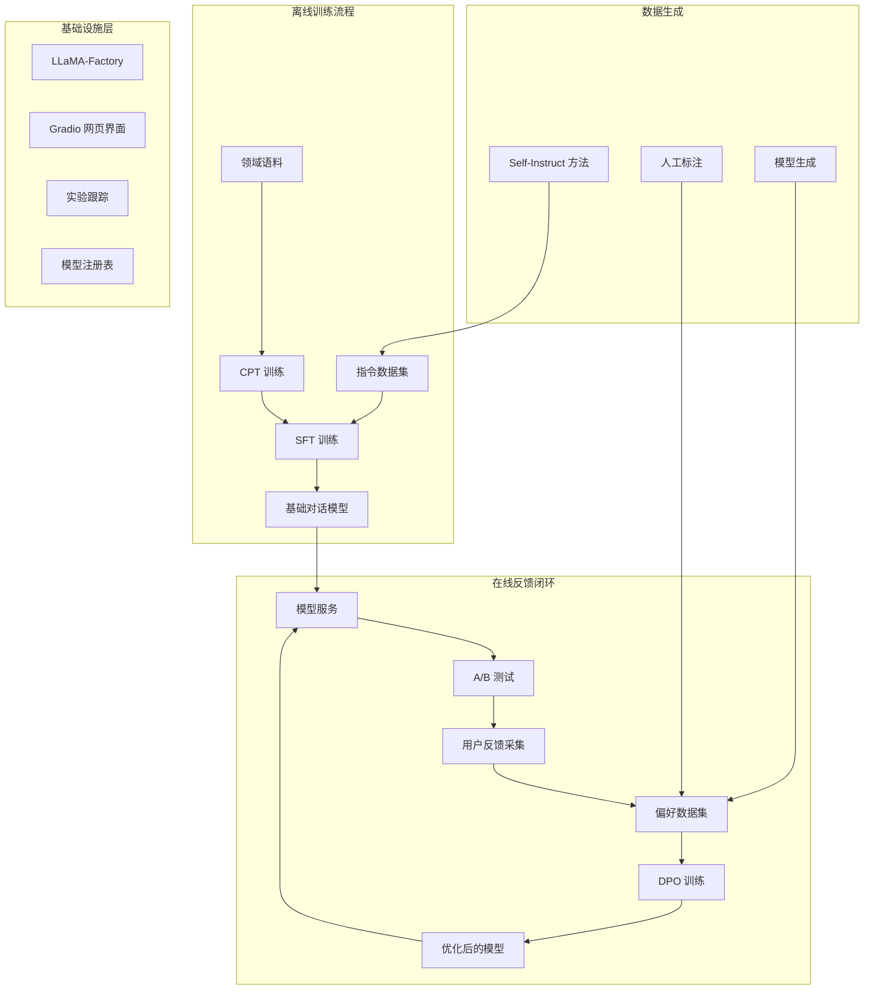
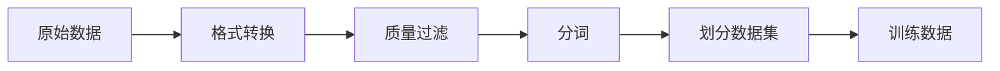

# 训练与反馈的实现边界

[项目说明](../../../../README.md) · [当前模块说明](../../README.md)

训练页面负责收集参数，Runner 校验并整理配置，训练器生成配置文件后启动 `llamafactory-cli train` 子进程。推理加载与训练是不同操作，模型路径也需要分别确认。

偏好采集器负责保存用户选择，数据生成器负责准备 CPT/SFT 数据。当前代码没有把采集、训练、评估、灰度发布和回滚组成无人值守的生产编排系统。

## 怎样验证

1. 预览训练配置，核对阶段、输入模型、数据集、输出目录。
2. 启动真实训练后查看子进程日志与输出文件，而不是只看“已启动”状态。
3. 完成后单独加载模型并评估，再决定是否用于后续任务。

## 使用边界

原图解中的训练集群、模型注册中心、在线流量切分等属于架构参考，不能据此认定当前本地工作台已经部署了这些设施。

## 实现入口

- [src/search_engine/training_tab/llmops_tab.py](../../../../src/search_engine/training_tab/llmops_tab.py)
- [src/search_engine/training_tab/llmops_runner.py](../../../../src/search_engine/training_tab/llmops_runner.py)
- [src/search_engine/training_tab/llamafactory_trainer.py](../../../../src/search_engine/training_tab/llamafactory_trainer.py)
- [src/search_engine/training_tab/preference_collector.py](../../../../src/search_engine/training_tab/preference_collector.py)

## 代码与图解参考

下列内容保留原有讲义中的代码、图解和输入输出示例。它们用于理解设计，可能省略初始化、依赖或使用旧接口；当前调用方式以本页“实现入口”链接的源码为准。示例中的指标、耗时和结果不作为本项目的验收数据。

<details>
<summary>展开代码与图解示例</summary>

### 示例 1



### 示例 2



### 示例 3

```
├── 数据生成
│   └── Self-Instruct 脚本
├── 训练节点
│   ├── LLaMA-Factory
│   └── GPU 资源
├── 评估节点
│   └── 基准测试集
└── 网页界面
    └── Gradio 界面
```

### 示例 4

```
├── 数据处理流程
│   ├── 用户反馈采集器
│   └── 偏好数据集构建器
├── 训练集群
│   ├── 主节点（编排）
│   └── 工作节点（GPU 训练）
├── 推理服务集群
│   ├── 负载均衡器
│   ├── 模型服务（A/B 版本）
│   └── 监控
└── 存储
    ├── 模型注册表
    └── 训练数据
```

### 示例 5

```python
# Training API
POST /train/cpt
POST /train/sft
POST /train/dpo

# Serving API
POST /predict
GET /models
POST /feedback

# Management API
GET /experiments
GET /metrics
POST /deploy
```

</details>
