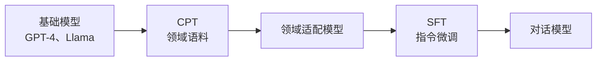

# 领域语料与继续预训练

[项目说明](../../../../README.md) · [当前模块说明](../../README.md)

继续预训练使用领域文本延续语言模型训练，目标是让模型适应语料分布。它与把文档放入检索索引不同：前者改变模型参数，后者改变推理时可获得的材料。

当前语料处理器从预置文档加载文本，支持清理、去重、按长度切分、保存及数据集注册。页面再把所选基础模型、语料和参数交给训练器执行。

## 怎样验证

1. 先查看清理后的语料和统计，检查空文本、重复及切分结果。
2. 核对注册的数据集实际指向的文件，记录基础模型与输出路径。
3. 训练后结合损失、领域任务与通用能力对照评估，确认是否发生收益或退化。

## 使用边界

语料处理的长度设置不能自动代表 tokenizer 的精确词元数。训练效果、显存和耗时取决于模型、数据及硬件，不使用旧示例中的固定时长作为承诺。

## 实现入口

- [src/search_engine/training_tab/domain_corpus_processor.py](../../../../src/search_engine/training_tab/domain_corpus_processor.py)
- [src/search_engine/training_tab/llmops_tab.py](../../../../src/search_engine/training_tab/llmops_tab.py)
- [src/search_engine/training_tab/llamafactory_trainer.py](../../../../src/search_engine/training_tab/llamafactory_trainer.py)

## 公式参考

以下保留原有公式。变量、特征与数据分布须结合当前实现解释，公式本身不代表已经完成对应评估。

$$
\mathcal{L}_{\text{CPT}} = -\sum_{t=1}^{T} \log P(x_t \mid x_{<t}; \theta)
$$

## 代码与图解参考

下列内容保留原有讲义中的代码、图解和输入输出示例。它们用于理解设计，可能省略初始化、依赖或使用旧接口；当前调用方式以本页“实现入口”链接的源码为准。示例中的指标、耗时和结果不作为本项目的验收数据。

<details>
<summary>展开代码与图解示例</summary>

### 示例 1



### 示例 2

```jsonl
{"text": "Domain-specific document content..."}
{"text": "Another document in the domain..."}
```

### 示例 3

```yaml
# CPT Configuration Example
model_name_or_path: Qwen/Qwen2.5-0.5B-Instruct
stage: pt  # pre-training stage
do_train: true
dataset: domain_corpus
template: default

# Training hyperparameters
cutoff_len: 2048
max_samples: 100000
per_device_train_batch_size: 4
gradient_accumulation_steps: 8
learning_rate: 2.0e-5
num_train_epochs: 3.0
lr_scheduler_type: cosine
warmup_ratio: 0.1

# Optimization
fp16: true
ddp_timeout: 180000000

# LoRA configuration
finetuning_type: lora
lora_target: all
lora_rank: 16
lora_alpha: 32
lora_dropout: 0.05

# Output
output_dir: checkpoints/cpt/domain-model
logging_steps: 10
save_steps: 1000
```

### 示例 4

```python
# Collect domain-specific documents
domain_docs = [
    {"text": "Medical journal article..."},
    {"text": "Clinical trial report..."},
    # ... more documents
]
```

### 示例 5

```python
import json

# Convert to JSONL format
with open('data/llmops/cpt/domain_corpus.jsonl', 'w') as f:
    for doc in domain_docs:
        f.write(json.dumps(doc, ensure_ascii=False) + '\n')
```

### 示例 6

```json
{
  "domain_corpus": {
    "file_name": "cpt/domain_corpus.jsonl"
  }
}
```

### 示例 7

```bash
cd LLaMA-Factory

llamafactory-cli train \
    --config_file config/cpt_config.yaml
```

### 示例 8

```python
from llamafactory import Trainer

# Load configuration
config = yaml.safe_load(open('config/cpt_config.yaml'))

# Initialize trainer
trainer = Trainer(config)

# Start training
trainer.train()
```

### 示例 9

```bash
tensorboard --logdir=checkpoints/cpt/domain-model/runs
```

### 示例 10

   ```python
   def filter_quality(doc):
       # Remove too short documents
       if len(doc['text'].split()) < 50:
           return False
       # Remove documents with high repetition
       if has_high_repetition(doc['text']):
           return False
       return True
   ```

### 示例 11

```yaml
# Enable gradient checkpointing
gradient_checkpointing: true

# Use smaller batch size with more accumulation
per_device_train_batch_size: 2
gradient_accumulation_steps: 16

# Quantization
quantization_bit: 4  # QLoRA
```

### 示例 12

```python
from transformers import AutoModelForCausalLM, AutoTokenizer
import torch

# Load model
model = AutoModelForCausalLM.from_pretrained(
    "checkpoints/cpt/domain-model"
)
tokenizer = AutoTokenizer.from_pretrained(
    "checkpoints/cpt/domain-model"
)

# Calculate perplexity on held-out set
def calculate_perplexity(text):
    encodings = tokenizer(text, return_tensors="pt")
    max_length = model.config.n_positions
    stride = 512

    lls = []
    for i in range(0, encodings.input_ids.size(1), stride):
        begin_loc = max(i + stride - max_length, 0)
        end_loc = min(i + stride, encodings.input_ids.size(1))
        trg_len = end_loc - i

        input_ids = encodings.input_ids[:, begin_loc:end_loc]
        target_ids = input_ids.clone()
        target_ids[:, :-trg_len] = -100

        with torch.no_grad():
            outputs = model(input_ids, labels=target_ids)
            log_likelihood = outputs.loss * trg_len

        lls.append(log_likelihood)

    ppl = torch.exp(torch.stack(lls).sum() / end_loc)
    return ppl.item()

# Evaluate
test_texts = load_test_corpus()
perplexities = [calculate_perplexity(text) for text in test_texts]
avg_ppl = sum(perplexities) / len(perplexities)

print(f"Average Perplexity: {avg_ppl:.2f}")
```

### 示例 13

  ```yaml
  max_grad_norm: 1.0
  ```

### 示例 14

```yaml
# Medical CPT Configuration
model_name_or_path: Qwen/Qwen2.5-0.5B-Instruct
stage: pt
dataset: medical_corpus  # PubMed abstracts, clinical notes

# Optimized for medical domain
cutoff_len: 2048  # Medical texts can be long
learning_rate: 1.5e-5  # Lower LR for stability
num_train_epochs: 2.0  # Prevent overfitting
```

</details>
