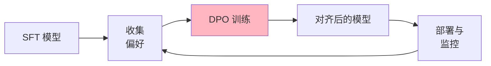
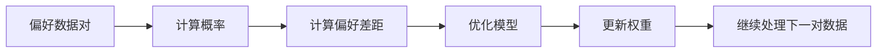
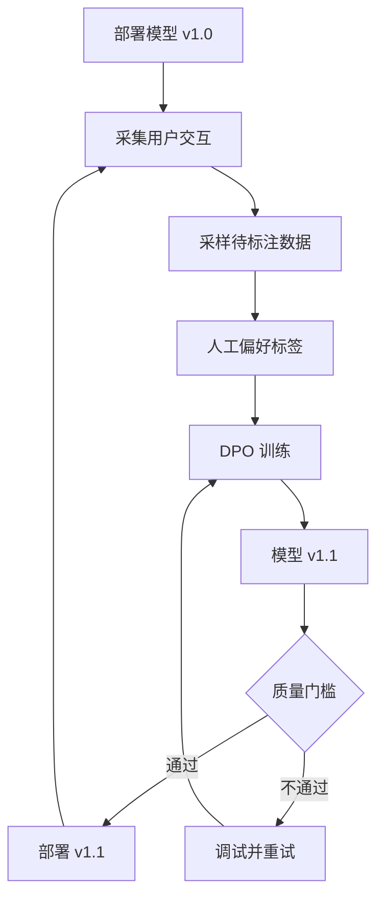

# 偏好数据与 DPO 训练

[项目说明](../../../../README.md) · [当前模块说明](../../README.md)

直接偏好优化使用同一输入下的“选中回答”和“拒绝回答”训练模型，相对参考模型优化偏好。它不需要在这一训练流程中单独拟合一个奖励模型；方法依据见 [DPO 原论文](https://arxiv.org/abs/2305.18290)。

当前页面采集偏好后由 `PreferenceCollector` 保存，再导出含 conversations、chosen、rejected 的训练数据并注册。实际训练由 LLaMA-Factory 子进程执行，参数和数据读取取决于生成的配置。

## 怎样验证

1. 确认每对回答来自同一问题且内容非空，核对 chosen/rejected 没有颠倒。
2. 核对导出文件、数据集注册、SFT 输入模型和训练配置。
3. 训练后使用固定的独立问题集比较结果，同时记录采样参数和人工选择标准。

## 使用边界

偏好数据中的胜者不等于客观正确答案；位置、采样温度和标注习惯会影响选择。公式中的 beta 是训练目标的系数，不是生成回答时的 temperature；不能把二者当成同一个调节项。

## 实现入口

- [src/search_engine/training_tab/preference_collector.py](../../../../src/search_engine/training_tab/preference_collector.py)
- [src/search_engine/training_tab/llmops_tab.py](../../../../src/search_engine/training_tab/llmops_tab.py)
- [src/search_engine/training_tab/llamafactory_trainer.py](../../../../src/search_engine/training_tab/llamafactory_trainer.py)

## 公式参考

以下保留原有公式。变量、特征与数据分布须结合当前实现解释，公式本身不代表已经完成对应评估。

$$
\mathcal{L}_{\text{DPO}} = -\log \sigma \left( \beta \log \frac{\pi_\theta(y_w \mid x)}{\pi_{\text{ref}}(y_w \mid x)} - \beta \log \frac{\pi_\theta(y_l \mid x)}{\pi_{\text{ref}}(y_l \mid x)} \right)
$$

## 代码与图解参考

下列内容保留原有讲义中的代码、图解和输入输出示例。它们用于理解设计，可能省略初始化、依赖或使用旧接口；当前调用方式以本页“实现入口”链接的源码为准。示例中的指标、耗时和结果不作为本项目的验收数据。

<details>
<summary>展开代码与图解示例</summary>

### 示例 1



### 示例 2



### 示例 3

```json
{
  "conversations": [
    {"from": "user", "value": "Explain quantum computing"}
  ],
  "chosen": "Quantum computing uses quantum mechanical phenomena like superposition...",
  "rejected": "Quantum computing is when computers use quantum."
}
```

### 示例 4

```json
{
  "conversations": [
    {"from": "user", "value": "What is Python?"},
    {"from": "assistant", "value": "Python is a programming language."},
    {"from": "user", "value": "Show me an example"}
  ],
  "chosen": "Here's a simple Python example:\n\n```python\nprint('Hello, World!')\n```\n\nThis is the traditional first program...",
  "rejected": "Sure: print('hi')"
}
```

### 示例 5

```yaml
# DPO Configuration
model_name_or_path: checkpoints/sft/chat-model
ref_model: checkpoints/sft/chat-model  # Reference model
stage: dpo
do_train: true
dataset: comparison_gpt4_en
template: qwen

# DPO-specific parameters
pref_beta: 0.1  # KL penalty coefficient
pref_loss: sigmoid  # or hinge, ipo

# Training hyperparameters
cutoff_len: 2048
per_device_train_batch_size: 1
gradient_accumulation_steps: 32
learning_rate: 5.0e-7  # Much lower than SFT!
num_train_epochs: 1.0  # Usually just 1 epoch
lr_scheduler_type: cosine
warmup_ratio: 0.1

# Optimization
fp16: true
gradient_checkpointing: true

# LoRA configuration
finetuning_type: lora
lora_target: all
lora_rank: 16
lora_alpha: 32

# Evaluation
val_size: 0.1
eval_strategy: steps
eval_steps: 100

# Output
output_dir: checkpoints/dpo/aligned-model
logging_steps: 5
save_steps: 500
```

### 示例 6

```python
import gradio as gr

def create_preference_ui(model_a, model_b):
    """Create UI for collecting preference data"""

    def get_responses(prompt):
        response_a = model_a.generate(prompt)
        response_b = model_b.generate(prompt)
        return response_a, response_b

    def save_preference(prompt, response_a, response_b, preference):
        """Save user preference"""
        if preference == "A":
            chosen, rejected = response_a, response_b
        else:
            chosen, rejected = response_b, response_a

        preference_data = {
            "conversations": [{"from": "user", "value": prompt}],
            "chosen": chosen,
            "rejected": rejected
        }

        with open('data/llmops/dpo/preferences.jsonl', 'a') as f:
            f.write(json.dumps(preference_data) + '\n')

    # Create Gradio interface
    with gr.Blocks() as demo:
        prompt_input = gr.Textbox(label="Enter prompt")
        get_btn = gr.Button("Generate Responses")

        with gr.Row():
            response_a = gr.Textbox(label="Response A")
            response_b = gr.Textbox(label="Response B")

        with gr.Row():
            prefer_a = gr.Button("Prefer A")
            prefer_b = gr.Button("Prefer B")

        get_btn.click(
            get_responses,
            inputs=[prompt_input],
            outputs=[response_a, response_b]
        )

        prefer_a.click(
            lambda p, a, b: save_preference(p, a, b, "A"),
            inputs=[prompt_input, response_a, response_b]
        )

    return demo

# Launch UI
demo = create_preference_ui(model_a, model_b)
demo.launch()
```

### 示例 7

```python
from openai import OpenAI

client = OpenAI()

def generate_preference_with_gpt4(prompt, response_a, response_b):
    """Use GPT-4 to judge which response is better"""

    judge_prompt = f"""Compare the following two responses to the user prompt and determine which is better.

User Prompt: {prompt}

Response A:
{response_a}

Response B:
{response_b}

Evaluate based on:
1. Helpfulness
2. Accuracy
3. Clarity
4. Safety

Respond with ONLY "A" or "B" to indicate which response is better."""

    response = client.chat.completions.create(
        model="gpt-4",
        messages=[{"role": "user", "content": judge_prompt}],
        temperature=0.0
    )

    choice = response.choices[0].message.content.strip()

    if choice == "A":
        return {"chosen": response_a, "rejected": response_b}
    else:
        return {"chosen": response_b, "rejected": response_a}
```

### 示例 8

```bash
llamafactory-cli train \
    --config_file config/dpo_config.yaml
```

### 示例 9

```bash
tensorboard --logdir=checkpoints/dpo/aligned-model/runs
```

### 示例 10

```python
def evaluate_win_rate(test_prompts, model_before, model_after):
    """Evaluate improvement after DPO"""

    wins = 0
    total = len(test_prompts)

    for prompt in test_prompts:
        response_before = model_before.generate(prompt)
        response_after = model_after.generate(prompt)

        # Human or GPT-4 judge
        winner = judge(prompt, response_before, response_after)

        if winner == "after":
            wins += 1

    win_rate = wins / total
    return win_rate

# Expect 60-80% win rate for successful DPO
```

### 示例 11

```yaml
# Lower learning rate
learning_rate: 1.0e-7

# Increase KL penalty
pref_beta: 0.2

# Enable gradient clipping
max_grad_norm: 0.5
```

### 示例 12



### 示例 13

```python
# Data format with multiple preference dimensions
{
  "conversations": [...],
  "chosen": "...",
  "rejected": "...",
  "dimensions": {
    "helpfulness": {"chosen": 5, "rejected": 3},
    "safety": {"chosen": 5, "rejected": 4},
    "accuracy": {"chosen": 4, "rejected": 2}
  }
}
```

### 示例 14

```yaml
# Round 1: General helpfulness
dataset: preferences_helpfulness

# Round 2: Safety
dataset: preferences_safety

# Round 3: Domain-specific
dataset: preferences_domain
```

</details>
