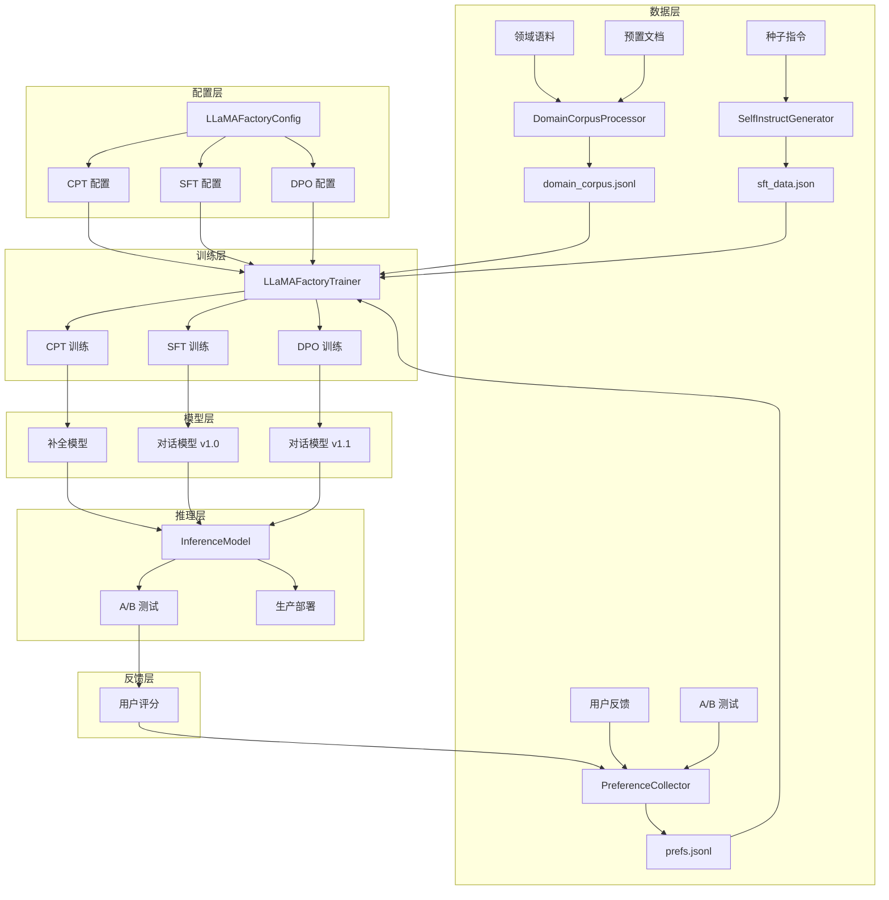
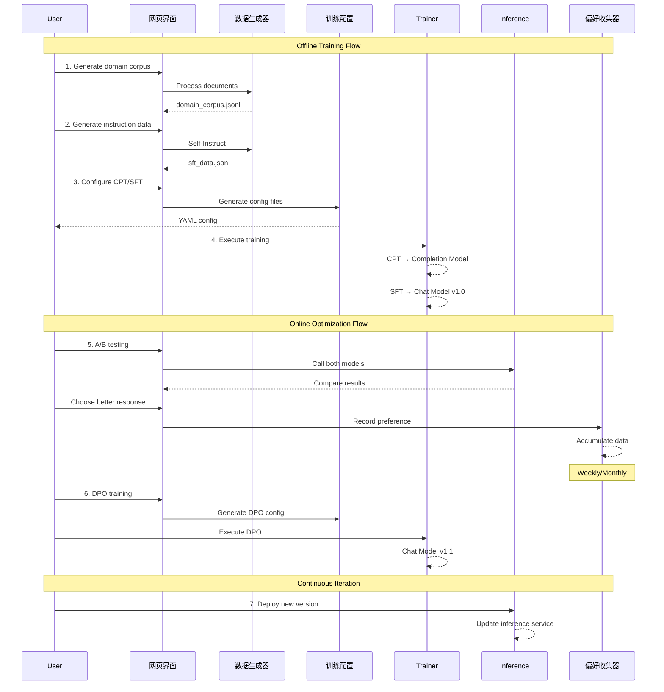
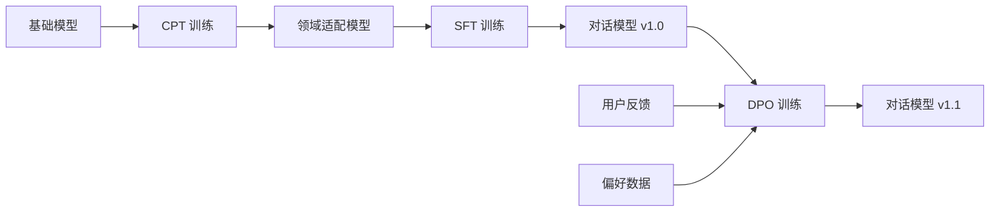
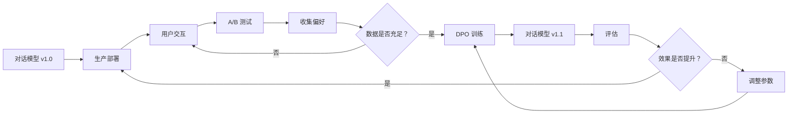

# 训练与反馈阅读路径

[项目说明](../../../../README.md) · [当前模块说明](../../README.md)

该模块的安装和当前操作步骤统一维护在模块 README，本页用于连接原讲义中的图解和代码。先读模块主说明，完成一次最小操作，再按具体问题进入专题，避免在多份总览中重复维护参数与启动命令。

## 怎样验证

1. 确认输入材料、所选模型或服务已经就绪。
2. 执行一个能观察到实际结果的小任务，保留输入和输出。
3. 对照真实源码与运行结果判断能力，不使用概念图中的组件推断已部署功能。

## 使用边界

下面的原有示例可能包含旧版路径、模拟输出或未实现的扩展设计；当前操作只以模块 README 和源码为准。

## 实现入口

- [src/search_engine/training_tab/llmops_tab.py](../../../../src/search_engine/training_tab/llmops_tab.py)
- [src/search_engine/training_tab/llamafactory_trainer.py](../../../../src/search_engine/training_tab/llamafactory_trainer.py)
- [src/search_engine/training_tab/preference_collector.py](../../../../src/search_engine/training_tab/preference_collector.py)

## 代码与图解参考

下列内容保留原有讲义中的代码、图解和输入输出示例。它们用于理解设计，可能省略初始化、依赖或使用旧接口；当前调用方式以本页“实现入口”链接的源码为准。示例中的指标、耗时和结果不作为本项目的验收数据。

<details>
<summary>展开代码与图解示例</summary>

### 示例 1



### 示例 2



### 示例 3

```
src/search_engine/training_tab/
├── llmops_tab.py                    # 主界面入口
├── llmops_engine.py                 # 引擎协调器
├── llmops_manager.py                # 组件管理器
├── llmops_runner.py                 # 训练执行器
├── llmops_control.py                # 控制逻辑
├── llmops_models.py                 # 模型配置
├── llama_factory_config.py          # 生成 LLaMA-Factory 配置
├── llamafactory_trainer.py          # 训练服务
├── self_instruct_generator.py       # Self-Instruct 数据生成
├── domain_corpus_processor.py       # 领域语料处理
├── preference_collector.py          # 偏好数据采集
└── inference_model.py               # 推理服务

data/llmops/
├── dataset_info.json                # 数据集注册表
├── cpt/                            # CPT 数据
│   └── domain_corpus_*.jsonl
├── sft/                            # SFT 数据
│   └── sft_data_*.json
└── dpo/                            # DPO 数据
    └── prefs.jsonl

checkpoints/
├── cpt/                            # CPT 模型输出
├── sft/                            # SFT 模型输出
└── dpo/                            # DPO 模型输出

configs/llmops/
├── cpt_config_*.yaml               # CPT 配置文件
├── sft_config_*.yaml               # SFT 配置文件
└── dpo_config_*.yaml               # DPO 配置文件
```

### 示例 4



### 示例 5

```json
{
    "text": "This is a domain-specific text passage. Can be complete paragraphs, documents, or code snippets."
}
```

### 示例 6

```python
@staticmethod
def create_cpt_config(
    model_name: str = "Qwen/Qwen2-1.5B",
    dataset: str = "domain_corpus",
    output_dir: str = "checkpoints/cpt/domain-cpt",
    num_train_epochs: int = 1,
    learning_rate: float = 1e-5,
    per_device_train_batch_size: int = 2,
    gradient_accumulation_steps: int = 8,
    max_seq_length: int = 2048,
    lora_r: int = 16,
    lora_alpha: int = 32
) -> Dict[str, Any]:
    """CPT configuration generation"""
    return {
        "stage": "pt",  # pretrain
        "model_name_or_path": model_name,
        "dataset": dataset,
        "finetuning_type": "lora",
        "lora_rank": lora_r,
        "lora_alpha": lora_alpha,
        "num_train_epochs": num_train_epochs,
        "learning_rate": learning_rate,
        ...
    }
```

### 示例 7

```bash
# 1. Generate configuration
llamafactory-cli export configs/llmops/cpt_config_20231115.yaml

# 2. Execute training
llamafactory-cli train configs/llmops/cpt_config_20231115.yaml

# 3. Training outputs
checkpoints/cpt/domain-cpt/
├── adapter_config.json      # LoRA configuration
├── adapter_model.safetensors # LoRA weights
├── trainer_log.jsonl        # Training logs
└── training_args.bin        # Training arguments
```

### 示例 8

```json
{
    "messages": [
        {
            "role": "system",
            "content": "You are a helpful assistant."
        },
        {
            "role": "user",
            "content": "What is machine learning?"
        },
        {
            "role": "assistant",
            "content": "Machine learning is a subfield of artificial intelligence..."
        }
    ]
}
```

### 示例 9

```python
@staticmethod
def create_sft_config(
    model_name: str = "Qwen/Qwen2-1.5B",
    dataset: str = "sft_data",
    output_dir: str = "checkpoints/sft/sft-lora",
    num_train_epochs: int = 3,
    learning_rate: float = 5e-5,
    template: str = "qwen"
) -> Dict[str, Any]:
    """SFT configuration generation"""
    return {
        "stage": "sft",
        "model_name_or_path": model_name,
        "dataset": dataset,
        "template": template,  # Model conversation template
        "finetuning_type": "lora",
        ...
    }
```

### 示例 10

```json
{
    "conversations": [
        {
            "role": "user",
            "content": "Which is better, Python or Java?"
        }
    ],
    "chosen": {
        "role": "assistant",
        "content": "Python and Java each have advantages, depending on specific scenarios..."
    },
    "rejected": {
        "role": "assistant",
        "content": "Python is better."
    }
}
```

### 示例 11

```python
@staticmethod
def create_dpo_config(
    model_name: str = "Qwen/Qwen2-1.5B",
    adapter_path: str = "checkpoints/sft/sft-lora",
    dataset: str = "prefs",
    output_dir: str = "checkpoints/dpo/dpo-lora",
    num_train_epochs: int = 1,
    learning_rate: float = 5e-6,
    pref_beta: float = 0.1
) -> Dict[str, Any]:
    """DPO configuration generation"""
    return {
        "stage": "dpo",
        "model_name_or_path": model_name,
        "adapter_name_or_path": adapter_path,  # Load SFT weights
        "dataset": dataset,
        "pref_beta": pref_beta,  # KL divergence weight
        "pref_loss": "sigmoid",  # Loss function
        ...
    }
```

### 示例 12



### 示例 13

```bash
cd /Users/tyler/courseware-1/projects/Testbed
python start_system.py
```

### 示例 14

```bash
# CPT training
llamafactory-cli train configs/llmops/cpt_config_*.yaml

# SFT training
llamafactory-cli train configs/llmops/sft_config_*.yaml
```

### 示例 15

```bash
llamafactory-cli train configs/llmops/dpo_config_*.yaml
```

### 示例 16

```python
# CPT parameter recommendations
CPT_PARAMS = {
    "learning_rate": 1e-5,  # Lower learning rate
    "num_epochs": 1,        # 1-3 epochs
    "lora_rank": 16,        # Larger rank
    "batch_size": 2-4,      # Adjust based on GPU memory
}

# SFT parameter recommendations
SFT_PARAMS = {
    "learning_rate": 5e-5,  # Medium learning rate
    "num_epochs": 3,        # 3-5 epochs
    "lora_rank": 8,         # Medium rank
    "batch_size": 4-8,      # Adjust based on GPU memory
}

# DPO parameter recommendations
DPO_PARAMS = {
    "learning_rate": 5e-6,  # Very low learning rate
    "num_epochs": 1,        # 1 epoch
    "lora_rank": 8,         # Match SFT
    "pref_beta": 0.1,       # KL divergence weight
}
```

### 示例 17

```python
GRADUAL_ROLLOUT = {
    "stage_1": {"traffic": 0.05, "duration": "1 day"},   # 5% traffic
    "stage_2": {"traffic": 0.20, "duration": "2 days"},  # 20% traffic
    "stage_3": {"traffic": 0.50, "duration": "3 days"},  # 50% traffic
    "stage_4": {"traffic": 1.00, "duration": "stable"}   # 100% traffic
}
```

### 示例 18

```python
ROLLBACK_CONDITIONS = {
    "error_rate": 0.05,      # Error rate exceeds 5%
    "latency_p99": 2000,     # P99 latency exceeds 2s
    "user_feedback": -0.2    # User feedback drops 20%
}
```

### 示例 19

```yaml
# Reduce batch size
per_device_train_batch_size: 1

# Increase gradient accumulation
gradient_accumulation_steps: 16

# Reduce sequence length
cutoff_len: 512

# Use gradient checkpointing
gradient_checkpointing: true

# Use 8-bit quantization
quantization_bit: 8
```

### 示例 20

```yaml
# Lower learning rate
learning_rate: 1.0e-6

# Increase warmup
warmup_steps: 500

# Use gradient clipping
max_grad_norm: 1.0

# Check data quality
# - Ensure correct data format
# - Remove anomalous samples
```

### 示例 21

```python
# Validate data format
def validate_sft_data(data_file):
    with open(data_file, 'r') as f:
        data = json.load(f)

    for i, item in enumerate(data):
        # Check required fields
        assert "conversations" in item, f"Item {i} missing conversations"

        # Check conversation format
        for conv in item["conversations"]:
            assert "from" in conv, f"Item {i} conversation missing from"
            assert "value" in conv, f"Item {i} conversation missing value"
            assert conv["from"] in ["human", "gpt"], f"Invalid from field value"
```

### 示例 22

```json
{
    "your_dataset_name": {
        "file_name": "path/to/your_data.jsonl",
        "columns": {
            "prompt": "text"
        },
        "formatting": "sharegpt",
        "ranking": true
    }
}
```

### 示例 23

```python
# Training API
from llamafactory_trainer import get_trainer
trainer = get_trainer()
trainer.start_training(config)

# Data Generation API
from self_instruct_generator import SelfInstructGenerator
generator = SelfInstructGenerator()
data = generator.generate_instructions(num_instructions=100)

# Preference Collection API
from preference_collector import PreferenceCollector
collector = PreferenceCollector()
collector.collect_preference(question, response_a, response_b, choice)

# Inference API
from inference_model import InferenceModel
model = InferenceModel()
model.load_model("chat-v1", "Qwen/Qwen2-1.5B", "checkpoints/sft/sft-lora")
response = model.generate("chat-v1", "Hello", max_length=512)
```

</details>
