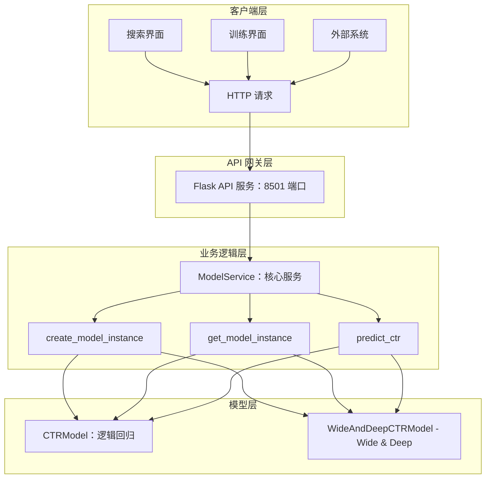

# 模型服务与接口边界

[项目说明](../../../README.md) · [当前模块说明](../README.md)

新版工作台通过 8766 端口的 Python 执行服务调用原业务函数。原 CTR 模型另有可选的独立 Flask API，默认 8501；统一启动脚本不会因此自动启动第二套 CTR API。

独立 CTR 服务由 `start_model_serving.py` 启动。当前路由包括 `GET /health`、`GET /v1/models`、`POST /v1/models/<model_name>/predict` 与 `/batch_predict`。单次预测读取 JSON 的 inputs 对象，批量预测读取 inputs 列表；旧示例中的 `:predict` 路径与此实现不一致。

## 怎样验证

1. 先明确使用工作台还是独立 CTR API，检查对应进程和端口。
2. 使用实际路由核对健康状态和模型列表，再检查模型是否已训练。
3. 对预测请求保留模型名、输入、响应与错误状态，确认输出来自实际加载的模型。

## 使用边界

本轮文档核对没有启动独立 CTR API、付费模型调用或训练任务。工作台传输验收不能替代模型服务的负载、质量和部署验证。

## 实现入口

- [src/search_engine/model_service.py](../../../src/search_engine/model_service.py)
- [start_model_serving.py](../../../start_model_serving.py)
- [start_console.sh](../../../start_console.sh)
- [src/search_engine/workbench_api.py](../../../src/search_engine/workbench_api.py)

## 代码与图解参考

下列内容保留原有讲义中的代码、图解和输入输出示例。它们用于理解设计，可能省略初始化、依赖或使用旧接口；当前调用方式以本页“实现入口”链接的源码为准。示例中的指标、耗时和结果不作为本项目的验收数据。

<details>
<summary>展开代码与图解示例</summary>

### 示例 1



### 示例 2

```python
# File: src/search_engine/model_service.py
class ModelService:
    """Model service: handles model training, configuration, and model files"""
    
    def __init__(self, model_file: str = None):
        if model_file is None:
            model_file = os.path.join(os.getcwd(), "models", "ctr_model.pkl")
        self.model_file = model_file
        self.ctr_model = CTRModel()  # Default LR model
        self.current_model_type = "logistic_regression"
        self.model_instances = {}  # Store different model instances
        self._load_model()
        
        # Flask API service related
        self.flask_app = None
        self.api_running = False
```

### 示例 3

```python
def _setup_api_routes(self):
    """Setup API routes"""
    
    @self.flask_app.route('/health', methods=['GET'])
    def health():
        """Health check"""
        return jsonify({
            "status": "healthy",
            "model_type": self.current_model_type,
            "model_trained": self.ctr_model.is_trained
        })
    
    @self.flask_app.route('/v1/models', methods=['GET'])
    def list_models():
        """List all models"""
        # Returns list of available models
    
    @self.flask_app.route('/v1/models/<model_name>/predict', methods=['POST'])
    def predict(model_name):
        """Model prediction"""
        # Handles prediction requests
```

### 示例 4

```bash
curl -X GET http://localhost:8501/health
```

### 示例 5

```json
{
    "status": "healthy",
    "model_type": "logistic_regression",
    "model_trained": true
}
```

### 示例 6

```bash
curl -X GET http://localhost:8501/v1/models
```

### 示例 7

```json
{
    "model": [
        {
            "name": "logistic_regression",
            "status": "loaded",
            "type": "pickle"
        },
        {
            "name": "wide_and_deep",
            "status": "loaded", 
            "type": "tensorflow"
        }
    ]
}
```

### 示例 8

```bash
curl -X POST http://localhost:8501/v1/models/logistic_regression:predict \
  -H "Content-Type: application/json" \
  -d '{
    "inputs": {
      "query": "artificial intelligence",
      "doc_id": "test_doc_001",
      "position": 1,
      "score": 0.8,
      "summary": "AI technology introduction"
    }
  }'
```

### 示例 9

```json
{
    "outputs": {
        "ctr_score": 0.123456
    }
}
```

### 示例 10

```bash
curl -X POST http://localhost:8501/v1/models/logistic_regression/batch_predict \
  -H "Content-Type: application/json" \
  -d '{
    "inputs": [
      {
        "query": "machine learning",
        "doc_id": "doc1",
        "position": 1,
        "score": 0.9,
        "summary": "ML introduction"
      },
      {
        "query": "deep learning", 
        "doc_id": "doc2",
        "position": 2,
        "score": 0.7,
        "summary": "DL introduction"
      }
    ]
  }'
```

### 示例 11

```json
{
    "outputs": [
        {
            "ctr_score": 0.234567
        },
        {
            "ctr_score": 0.345678
        }
    ]
}
```

### 示例 12

```python
def get_model_instance(self, model_type: str):
    """Get model instance of specified type"""
    # Recreate instance each time to ensure latest model is loaded
    # This solves the model synchronization issue after training
    self.model_instances[model_type] = self.create_model_instance(model_type)
    return self.model_instances[model_type]

def create_model_instance(self, model_type: str):
    """Create model instance of specified type"""
    try:
        if model_type == 'logistic_regression':
            from .training_tab.ctr_model import CTRModel
            model_instance = CTRModel()
            model_file = os.path.join(os.getcwd(), "models", "ctr_model.pkl")
        elif model_type == 'wide_and_deep':
            from .training_tab.ctr_wide_deep_model import WideAndDeepCTRModel
            model_instance = WideAndDeepCTRModel()
            model_file = os.path.join(os.getcwd(), "models", "wide_deep_ctr_model")
        else:
            raise ValueError(f"Unsupported model type: {model_type}")
        
        model_instance.load_model(model_file)
        self.model_instances[model_type] = model_instance
        return model_instance
        
    except Exception as e:
        print(f"Failed to create model instance: {e}")
        # Fallback to default LR model
        from .training_tab.ctr_model import CTRModel
        return CTRModel()
```

### 示例 13

```python
def check_and_start_model_service():
    """Check and start model service (independent process)"""
    # 1. Check if service is running
    model_service_url = "http://localhost:8501/health"
    try:
        req = request.Request(model_service_url, method="GET")
        with request.urlopen(req, timeout=2) as resp:
            if 200 <= resp.status < 300:
                print("✅ Detected running model service, reusing")
                return True
    except Exception:
        pass
    
    # 2. Start independent process
    model_service_script = os.path.join(os.path.dirname(__file__), 'start_model_serving.py')
    process = subprocess.Popen(
        [sys.executable, model_service_script],
        stdout=subprocess.PIPE,
        stderr=subprocess.PIPE,
        cwd=os.path.dirname(__file__)
    )
    
    # 3. Wait for service startup and verify
    time.sleep(3)
    try:
        req = request.Request(model_service_url, method="GET")
        with request.urlopen(req, timeout=5) as resp:
            if 200 <= resp.status < 300:
                print("✅ Model service independent process started successfully")
                return True
    except Exception as e:
        print(f"❌ Model service health check failed after startup: {e}")
        return False
```

### 示例 14

```bash
# Start model service independent process
python start_model_serving.py

# Background startup
python start_model_serving.py &

# Using process manager
python tools/model_service_manager.py start
python tools/model_service_manager.py stop
python tools/model_service_manager.py restart
python tools/model_service_manager.py status
python tools/model_service_manager.py health
```

### 示例 15

```python
import sys
sys.path.append('src')
from search_engine.model_service import ModelService

# Create and start service
model_service = ModelService()
model_service.start_api_server(port=8501)
```

### 示例 16

```python
def start_api_server(self, host="0.0.0.0", port=8501, debug=False):
    """Start Flask API server (independent process mode)"""
    try:
        if self.api_running:
            print("⚠️ API server already running")
            return True
        
        self.flask_app = Flask(__name__)
        self._setup_api_routes()
        
        self.api_running = True
        print(f"🚀 Model Serving API started at {host}:{port}")
        
        # Run Flask server directly (independent process mode)
        self.flask_app.run(
            host=host, 
            port=port, 
            debug=debug, 
            threaded=True,  # Enable multi-threading
            use_reloader=False
        )
        
    except Exception as e:
        print(f"❌ Failed to start API server: {e}")
        return False
```

### 示例 17

```python
@self.flask_app.route('/v1/models/<model_name>/batch_predict', methods=['POST'])
def batch_predict(model_name):
    """Batch prediction"""
    try:
        data = request.get_json()
        inputs_list = data.get('inputs', [])
        
        # Execute batch prediction
        results = []
        for inputs in inputs_list:
            ctr_score = self.predict_ctr(inputs, model_name)
            results.append({"ctr_score": ctr_score})
        
        return jsonify({"outputs": results})
        
    except Exception as e:
        return jsonify({"error": str(e)}), 500
```

### 示例 18

```python
class ModelService:
    def __init__(self, model_file: str = None):
        self.model_instances = {}  # Store different model instances
```

### 示例 19

```python
def get_memory_usage(self) -> Dict[str, float]:
    """Get memory usage"""
    import psutil
    process = psutil.Process()
    memory_info = process.memory_info()
    
    return {
        "rss": memory_info.rss / 1024 / 1024,  # MB
        "vms": memory_info.vms / 1024 / 1024,  # MB
        "percent": process.memory_percent()
    }
```

### 示例 20

```python
def health_check(self) -> Dict[str, Any]:
    """Service health check"""
    return {
        "status": "healthy" if self.api_running else "unhealthy",
        "model_type": self.current_model_type,
        "model_trained": self.ctr_model.is_trained,
        "uptime": time.time() - self.start_time,
        "memory_usage": self.get_memory_usage()
    }
```

### 示例 21

```python
def model_health_check(self, model_type: str) -> bool:
    """Model health check"""
    try:
        model_instance = self.get_model_instance(model_type)
        if not model_instance.is_trained:
            return False
        
        # Test prediction
        test_inputs = {
            'query': 'test',
            'doc_id': 'test',
            'position': 1,
            'score': 0.5,
            'summary': 'test summary'
        }
        result = self.predict_ctr(test_inputs, model_type)
        return isinstance(result, (int, float)) and 0 <= result <= 1
    except Exception:
        return False
```

### 示例 22

```python
@app.errorhandler(404)
def not_found(error):
    return jsonify({"error": "Endpoint not found"}), 404

@app.errorhandler(500)
def internal_error(error):
    return jsonify({"error": "Internal server error"}), 500

@app.errorhandler(ValueError)
def value_error(error):
    return jsonify({"error": str(error)}), 400
```

### 示例 23

```python
def predict_ctr(self, features: Dict[str, Any], model_type: Optional[str] = None) -> float:
    """Predict CTR with fallback"""
    try:
        if model_type:
            model_instance = self.get_model_instance(model_type)
        else:
            model_instance = self.get_model_instance(self.current_model_type)
        
        if not model_instance.is_trained:
            return 0.1  # Default CTR
        
        return model_instance.predict_ctr(query, doc_id, position, score, summary)
        
    except Exception as e:
        print(f"❌ Prediction failed: {e}")
        return 0.1  # Default CTR value
```

### 示例 24

```bash
# Find process using port
lsof -i :8501

# Kill process
kill -9 <PID>

# Or use different port
model_service.start_api_server(port=8502)
```

### 示例 25

```python
# Check if model file exists
import os
model_path = "models/ctr_model.pkl"
if not os.path.exists(model_path):
    print(f"Model file does not exist: {model_path}")

# Check model file permissions
if not os.access(model_path, os.R_OK):
    print(f"No read permission for model file: {model_path}")
```

### 示例 26

```python
def validate_prediction_result(result: float) -> bool:
    """Validate prediction result"""
    if not isinstance(result, (int, float)):
        return False
    if not (0 <= result <= 1):
        return False
    return True
```

### 示例 27

```python
# Enable debug mode
model_service.start_api_server(port=8501, debug=True)
```

### 示例 28

```python
import logging

# Set verbose logging
logging.getLogger().setLevel(logging.DEBUG)
```

### 示例 29

```python
# Model service configuration
MODEL_SERVICE_CONFIG = {
    "host": "0.0.0.0",
    "port": 8501,
    "debug": False,
    "threaded": True
}

# Model file paths
CTR_MODEL_PATH = "models/ctr_model.pkl"
WIDE_DEEP_MODEL_PATH = "models/wide_deep_ctr_model"
WIDE_DEEP_H5_PATH = "models/wide_deep_ctr_model.h5"
WIDE_DEEP_TF_SERVING_PATH = "models/wide_deep_ctr_model_tf_serving/"

# Feature configuration
FEATURE_DIMENSIONS = {
    'logistic_regression': 5,
    'wide_and_deep': 'variable'
}
```

</details>
