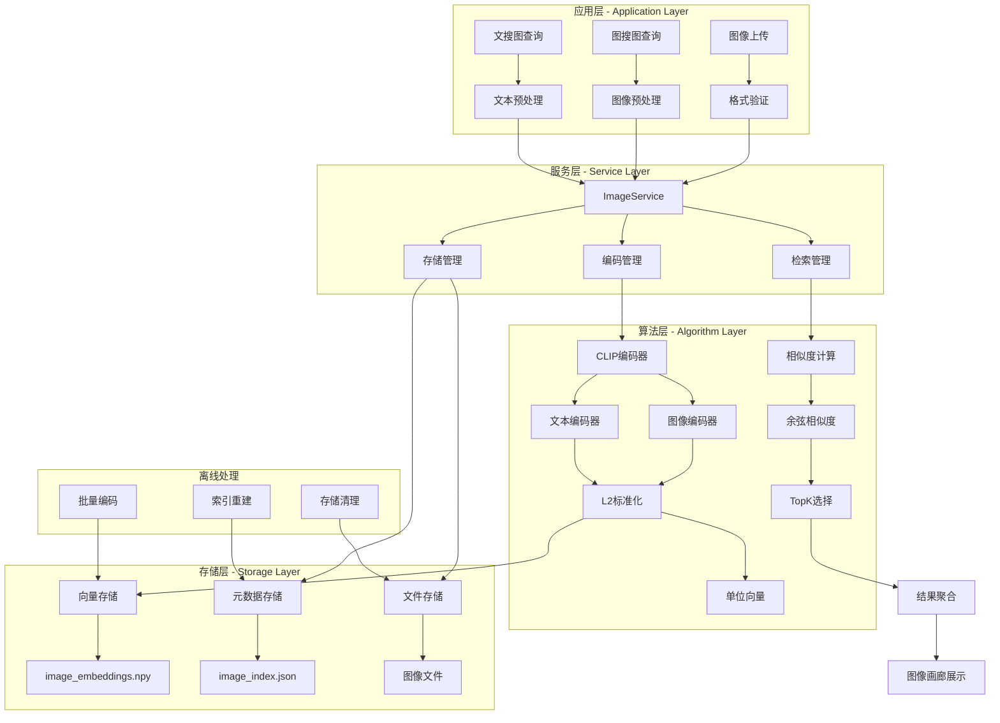
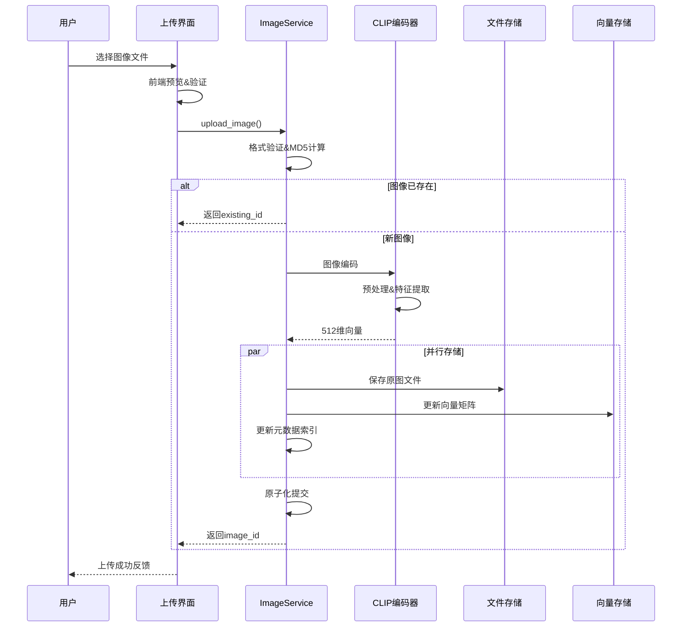
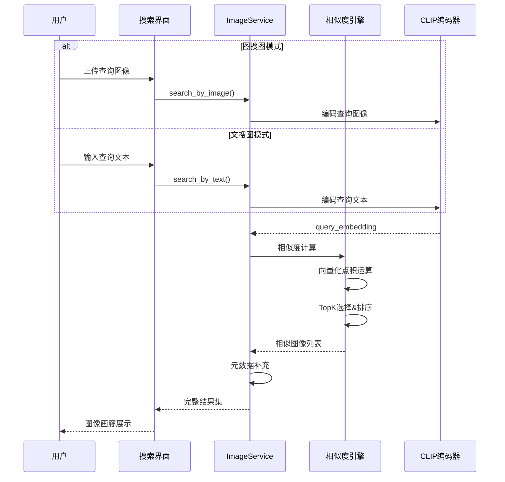
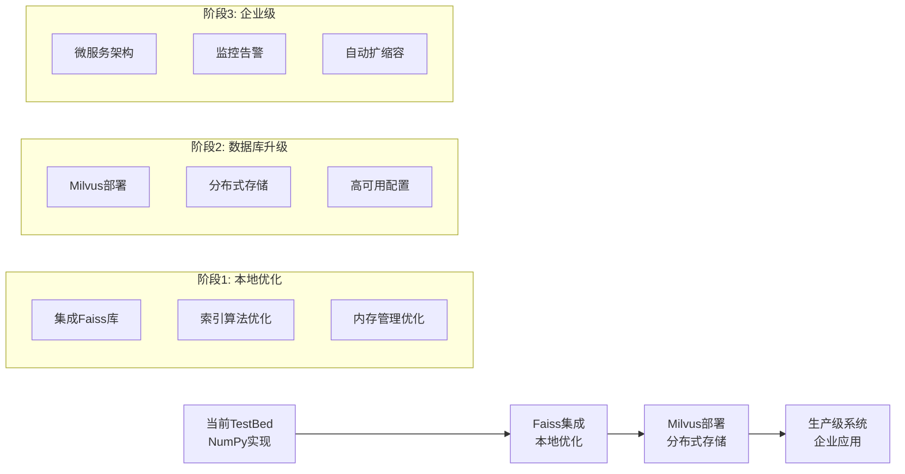

# 多模态系统：代码与图解参考

[当前模块说明](../README.md) · [项目说明](../../../README.md)

原指南重复维护的启动步骤、能力列表和固定性能数字已经移出主说明。使用当前工作台时，先按模块 README 完成操作；需要理解旧设计时再展开下方示例。

## 当前实现入口

- [src/search_engine/image_service.py](../../../src/search_engine/image_service.py)
- [src/search_engine/diffusion_service.py](../../../src/search_engine/diffusion_service.py)
- [image_generation_service.py](../../../image_generation_service.py)

## 代码与图解参考

下列内容保留原有讲义中的代码、图解和输入输出示例。它们用于理解设计，可能省略初始化、依赖或使用旧接口；当前调用方式以本页“实现入口”链接的源码为准。示例中的指标、耗时和结果不作为本项目的验收数据。

<details>
<summary>展开代码与图解示例</summary>

### 示例 1



### 示例 2

```python
# 文件路径: src/search_engine/image_service.py
import os
import json
import hashlib
import time
import shutil
from datetime import datetime
from typing import Dict, List, Tuple, Optional, Any
import numpy as np
from PIL import Image
import torch
from transformers import CLIPProcessor, CLIPModel
import cv2
from pathlib import Path

class ImageService:
    """图片索引服务 - 基于CLIP的图片检索"""
    
    def __init__(self, storage_dir: str = "models/images"):
        """
        初始化图片服务
        
        Args:
            storage_dir: 图片存储目录
        """
        self.storage_dir = Path(storage_dir)
        self.storage_dir.mkdir(parents=True, exist_ok=True)
        
        # 索引文件路径
        self.index_file = self.storage_dir / "image_index.json"
        self.embeddings_file = self.storage_dir / "image_embeddings.npy"
        
        # 初始化CLIP模型
        self.device = "cuda" if torch.cuda.is_available() else "cpu"
        self.model = None
        self.processor = None
        self._init_clip_model()
        
        # 图片索引和嵌入
        self.image_index: Dict[str, Dict] = {}
        self.image_embeddings: Optional[np.ndarray] = None
        self.image_ids: List[str] = []
        
        # 加载现有索引
        self._load_index()
    
    def _init_clip_model(self):
        """初始化CLIP模型"""
        try:
            print(f"🤖 初始化CLIP模型 (设备: {self.device})...")
            model_name = "openai/clip-vit-base-patch32"
            self.model = CLIPModel.from_pretrained(model_name).to(self.device)
            self.processor = CLIPProcessor.from_pretrained(model_name)
            print("✅ CLIP模型加载成功")
        except Exception as e:
            print(f"❌ CLIP模型加载失败: {e}")
            raise e
    
    def _load_index(self):
        """加载图片索引"""
        try:
            if self.index_file.exists():
                with open(self.index_file, 'r', encoding='utf-8') as f:
                    data = json.load(f)
                    self.image_index = data.get('images', {})
                    self.image_ids = list(self.image_index.keys())
                    print(f"📸 加载图片索引: {len(self.image_index)} 张图片")
            
            if self.embeddings_file.exists() and len(self.image_ids) > 0:
                self.image_embeddings = np.load(self.embeddings_file)
                print(f"🔢 加载图片嵌入: {self.image_embeddings.shape}")
            
        except Exception as e:
            print(f"⚠️ 加载索引失败: {e}")
            self.image_index = {}
            self.image_embeddings = None
            self.image_ids = []
    
    def _generate_image_id(self, image_path: str) -> str:
        """生成图像唯一ID - 使用MD5哈希"""
        with open(image_path, 'rb') as f:
            file_content = f.read()
            file_hash = hashlib.md5(file_content).hexdigest()
        return file_hash
    
    def _encode_image(self, image_path: str) -> np.ndarray:
        """图像编码核心逻辑 - CLIP视觉编码器"""
        try:
            # 1. 图像加载和预处理
            image = Image.open(image_path).convert('RGB')  # 统一RGB格式
            inputs = self.processor(images=image, return_tensors="pt").to(self.device)
            
            # 2. CLIP图像特征提取
            with torch.no_grad():
                image_features = self.model.get_image_features(**inputs)
                # L2标准化 - 确保余弦相似度计算的正确性
                image_features = image_features / image_features.norm(dim=-1, keepdim=True)
            
            return image_features.cpu().numpy().flatten()
            
        except Exception as e:
            print(f"❌ 图像编码失败 {image_path}: {e}")
            raise e
    
    def _encode_text(self, text: str) -> np.ndarray:
        """文本编码核心逻辑 - CLIP文本编码器"""
        try:
            # 1. 文本预处理
            inputs = self.processor(text=text, return_tensors="pt").to(self.device)
            
            # 2. CLIP文本特征提取
            with torch.no_grad():
                text_features = self.model.get_text_features(**inputs)
                # L2标准化 - 与图像特征在同一空间
                text_features = text_features / text_features.norm(dim=-1, keepdim=True)
            
            return text_features.cpu().numpy().flatten()
            
        except Exception as e:
            print(f"❌ 文本编码失败 '{text}': {e}")
            raise e
    
    def add_image(self, image_path: str, description: str = "", tags: List[str] = None) -> str:
        """添加图片到索引"""
        try:
            if not os.path.exists(image_path):
                raise FileNotFoundError(f"图片文件不存在: {image_path}")
            
            # 生成图片ID
            image_id = self._generate_image_id(image_path)
            
            if image_id in self.image_index:
                print(f"📸 图片已存在: {image_id}")
                return image_id
            
            # 复制图片到存储目录
            file_ext = Path(image_path).suffix
            stored_path = self.storage_dir / f"{image_id}{file_ext}"
            shutil.copy2(image_path, stored_path)
            
            # 编码图片
            print(f"🔄 正在编码图片: {Path(image_path).name}")
            embedding = self._encode_image(image_path)
            
            # 获取图片信息
            image = Image.open(image_path)
            width, height = image.size
            file_size = os.path.getsize(image_path)
            
            # 添加到索引
            self.image_index[image_id] = {
                'id': image_id,
                'original_name': Path(image_path).name,
                'stored_path': str(stored_path),
                'description': description,
                'tags': tags or [],
                'width': width,
                'height': height,
                'file_size': file_size,
                'format': image.format,
                'created_at': datetime.now().isoformat(),
                'embedding_index': len(self.image_ids)
            }
            
            # 更新嵌入矩阵
            if self.image_embeddings is None:
                self.image_embeddings = embedding.reshape(1, -1)
            else:
                self.image_embeddings = np.vstack([self.image_embeddings, embedding])
            
            self.image_ids.append(image_id)
            
            # 保存索引
            self._save_index()
            
            print(f"✅ 图片添加成功: {image_id}")
            return image_id
            
        except Exception as e:
            print(f"❌ 添加图片失败: {e}")
            raise e
    
    def search_by_image(self, query_image_path: str, top_k: int = 10) -> List[Dict]:
        """图搜图"""
        try:
            if len(self.image_ids) == 0:
                return []
            
            # 编码查询图片
            query_embedding = self._encode_image(query_image_path)
            
            # 计算相似度
            similarities = np.dot(self.image_embeddings, query_embedding)
            
            # 获取最相似的图片
            top_indices = np.argsort(similarities)[::-1][:top_k]
            
            results = []
            for idx in top_indices:
                image_id = self.image_ids[idx]
                image_info = self.image_index[image_id].copy()
                image_info['similarity'] = float(similarities[idx])
                results.append(image_info)
            
            return results
            
        except Exception as e:
            print(f"❌ 图搜图失败: {e}")
            return []
    
    def search_by_text(self, query_text: str, top_k: int = 10) -> List[Dict]:
        """文搜图"""
        try:
            if len(self.image_ids) == 0:
                return []
            
            # 编码查询文本
            query_embedding = self._encode_text(query_text)
            
            # 计算相似度
            similarities = np.dot(self.image_embeddings, query_embedding)
            
            # 获取最相似的图片
            top_indices = np.argsort(similarities)[::-1][:top_k]
            
            results = []
            for idx in top_indices:
                image_id = self.image_ids[idx]
                image_info = self.image_index[image_id].copy()
                image_info['similarity'] = float(similarities[idx])
                results.append(image_info)
            
            return results
            
        except Exception as e:
            print(f"❌ 文搜图失败: {e}")
            return []
    
    def _save_index(self):
        """保存图片索引"""
        try:
            # 保存图片元数据
            index_data = {
                'images': self.image_index,
                'last_updated': datetime.now().isoformat(),
                'total_images': len(self.image_index)
            }
            
            with open(self.index_file, 'w', encoding='utf-8') as f:
                json.dump(index_data, f, ensure_ascii=False, indent=2)
            
            # 保存嵌入向量
            if self.image_embeddings is not None:
                np.save(self.embeddings_file, self.image_embeddings)
            
            print(f"💾 图片索引已保存: {len(self.image_index)} 张图片")
            
        except Exception as e:
            print(f"❌ 保存索引失败: {e}")
```

### 示例 3

```python
# 存储层次结构
class ImageStorage:
    """三层存储架构"""
    
    # Layer 1: 向量存储 - 高性能数值计算
    image_embeddings: np.ndarray     # (N, 512) 向量矩阵
    
    # Layer 2: 元数据索引 - 快速查找
    image_index: Dict[str, Dict] = {
        "image_id": {
            "id": str,              # 图像ID (MD5哈希)
            "original_name": str,   # 原始文件名
            "stored_path": str,     # 存储路径
            "description": str,     # 用户描述
            "tags": List[str],      # 标签列表
            "width": int,           # 图像宽度
            "height": int,          # 图像高度
            "file_size": int,       # 文件大小
            "format": str,          # 图像格式
            "created_at": str,      # 创建时间
            "embedding_index": int  # 向量索引位置
        }
    }
    
    # Layer 3: 文件存储 - 原图保存
    # models/images/[md5_hash].[ext]
```

### 示例 4

```python
def add_image(self, image_path: str, description: str = "", tags: List[str] = None) -> str:
    """图像添加流程"""
    try:
        if not os.path.exists(image_path):
            raise FileNotFoundError(f"图片文件不存在: {image_path}")
        
        # 1. 去重检测 - MD5哈希避免重复存储
        image_id = self._generate_image_id(image_path)
        if image_id in self.image_index:
            return image_id  # 已存在，直接返回
        
        # 2. 复制图像文件到存储目录
        file_ext = Path(image_path).suffix
        stored_path = self.storage_dir / f"{image_id}{file_ext}"
        shutil.copy2(image_path, stored_path)
        
        # 3. 图像编码
        embedding = self._encode_image(image_path)
        
        # 4. 获取图像信息并更新索引
        image = Image.open(image_path)
        width, height = image.size
        file_size = os.path.getsize(image_path)
        
        self.image_index[image_id] = {
            'id': image_id,
            'original_name': Path(image_path).name,
            'stored_path': str(stored_path),
            'description': description,
            'tags': tags or [],
            'width': width,
            'height': height,
            'file_size': file_size,
            'format': image.format,
            'created_at': datetime.now().isoformat(),
            'embedding_index': len(self.image_ids)
        }
        
        # 5. 更新向量矩阵和ID列表
        if self.image_embeddings is None:
            self.image_embeddings = embedding.reshape(1, -1)
        else:
            self.image_embeddings = np.vstack([self.image_embeddings, embedding])
        
        self.image_ids.append(image_id)
        
        # 6. 保存索引
        self._save_index()
        
        return image_id
        
    except Exception as e:
        print(f"❌ 添加图片失败: {e}")
        raise e
```

### 示例 5

```python
# 在ImageService类中的实际实现
def search_by_image(self, query_image_path: str, top_k: int = 10) -> List[Dict]:
    """图搜图功能"""
    try:
        if len(self.image_ids) == 0:
            return []
        
        # 编码查询图片
        query_embedding = self._encode_image(query_image_path)
        
        # 计算相似度 - 向量点积运算
        similarities = np.dot(self.image_embeddings, query_embedding)
        
        # 获取最相似的图片 - 简单排序
        top_indices = np.argsort(similarities)[::-1][:top_k]
        
        # 构建结果
        results = []
        for idx in top_indices:
            image_id = self.image_ids[idx]
            image_info = self.image_index[image_id].copy()
            image_info['similarity'] = float(similarities[idx])
            results.append(image_info)
        
        return results
        
    except Exception as e:
        print(f"❌ 图搜图失败: {e}")
        return []

def search_by_text(self, query_text: str, top_k: int = 10) -> List[Dict]:
    """文搜图功能"""
    try:
        if len(self.image_ids) == 0:
            return []
        
        # 编码查询文本
        query_embedding = self._encode_text(query_text)
        
        # 计算相似度 - 与图搜图相同逻辑
        similarities = np.dot(self.image_embeddings, query_embedding)
        top_indices = np.argsort(similarities)[::-1][:top_k]
        
        results = []
        for idx in top_indices:
            image_id = self.image_ids[idx]
            image_info = self.image_index[image_id].copy()
            image_info['similarity'] = float(similarities[idx])
            results.append(image_info)
        
        return results
        
    except Exception as e:
        print(f"❌ 文搜图失败: {e}")
        return []
```

### 示例 6



### 示例 7



### 示例 8

```
src/search_engine/
├── image_service.py                # 图像服务核心实现★
├── image_tab/                      # 图像搜索模块
│   ├── __init__.py                # 模块初始化
│   └── image_tab.py               # UI界面和交互逻辑
├── portal.py                       # 主入口和界面编排
└── service_manager.py              # 服务管理器

test_images/                        # 测试图像目录
├── *.jpg                          # 测试图像文件
├── image_embeddings.npy           # 测试向量数据
└── image_index.json               # 测试索引文件

models/images/                      # 生产图像存储
├── image_index.json               # 图像元数据索引★
├── image_embeddings.npy           # 图像向量矩阵★  
└── *.{jpg,png,jpeg}               # 存储的图像文件
```

### 示例 9

```
models/images/                      # 图像存储根目录
├── image_index.json               # 元数据索引文件
│   └── {
│       "images": {                # 图像数据集合
│           "image_id": {          # MD5哈希ID
│               "id": "image_id",
│               "original_name": "原始文件名",
│               "stored_path": "存储路径",
│               "description": "图像描述", 
│               "tags": ["标签1", "标签2"],
│               "width": 宽度,
│               "height": 高度,
│               "file_size": 文件大小,
│               "format": "JPEG",
│               "created_at": "创建时间",
│               "embedding_index": 向量索引位置
│           }
│       },
│       "last_updated": "最后更新时间",
│       "total_images": 总图像数
│   }
├── image_embeddings.npy           # 向量矩阵 [N, 512]
│   └── numpy array: shape (图像数量, 512维特征)
└── {image_id}.{ext}               # 实际图像文件
    ├── 7455d85a2a97df695a67091744fc634c.jpeg
    ├── 894892f5758df042084f818092cdad58.png
    └── ...
```

### 示例 10

```python
# 图像服务主入口 - src/search_engine/image_service.py
def add_image(image_path: str, description: str = "", tags: List[str] = None) -> str:
    """
    添加图像到索引
    
    Args:
        image_path: 图像文件路径
        description: 图像描述
        tags: 标签列表
    
    Returns:
        图像ID (MD5哈希)
    """

def search_by_image(query_image_path: str, top_k: int = 10) -> List[Dict]:
    """
    图搜图功能
    
    Args:
        query_image_path: 查询图像路径
        top_k: 返回结果数量
    
    Returns:
        包含相似度的图像信息字典列表
    """

def search_by_text(query_text: str, top_k: int = 10) -> List[Dict]:
    """
    文搜图功能
    
    Args:
        query_text: 查询文本
        top_k: 返回结果数量
    
    Returns:
        包含相似度的图像信息字典列表
    """

# 图像界面入口 - src/search_engine/image_tab/image_tab.py
def build_image_tab(image_service) -> None:
    """
    构建图像搜索界面
    
    Args:
        image_service: ImageService实例
    """
```

### 示例 11

```python
# CLIP模型配置信息
MODEL_CONFIG = {
    "model_name": "openai/clip-vit-base-patch32",
    "vision_encoder": "ViT-B/32",          # Vision Transformer
    "text_encoder": "Transformer",         # 文本编码器
    "embedding_dim": 512,                  # 特征维度
    "image_size": 224,                     # 输入图像尺寸
    "patch_size": 32,                      # 图像块大小
    "vocab_size": 49408                    # 词汇表大小
}

# 设备配置
DEVICE_CONFIG = {
    "cuda": torch.cuda.is_available(),     # GPU可用性
    "device": "cuda" if torch.cuda.is_available() else "cpu",
    "dtype": torch.float32                 # 数据类型
}

# 存储配置
STORAGE_CONFIG = {
    "storage_dir": "models/images",        # 存储目录
    "index_file": "image_index.json",     # 索引文件名
    "embeddings_file": "image_embeddings.npy",  # 向量文件名
    "supported_formats": [".jpg", ".jpeg", ".png", ".bmp", ".gif"]
}
```

### 示例 12

```
models/images/
├── image_index.json      # 图像元数据索引
├── image_embeddings.npy  # 图像嵌入向量矩阵
└── [image_id].[ext]      # 存储的图像文件
```

### 示例 13

```python
# 当前TestBed实现 - 基于NumPy
class CurrentImageService:
    """当前基于NumPy的简单实现"""
    def __init__(self):
        self.image_embeddings = np.array([])  # 内存存储
        
    def search(self, query_embedding, top_k=10):
        # 暴力搜索 O(N)
        similarities = np.dot(self.image_embeddings, query_embedding)
        return np.argsort(similarities)[::-1][:top_k]

# 生产级优化 - Milvus向量数据库
class MilvusImageService:
    """基于Milvus的生产级实现"""
    def __init__(self):
        from pymilvus import connections, Collection
        connections.connect("default", host="localhost", port="19530")
        self.collection = Collection("image_embeddings")
        
    def search(self, query_embedding, top_k=10):
        # 近似最近邻搜索 O(log N)
        search_params = {"metric_type": "IP", "params": {"nprobe": 10}}
        results = self.collection.search(
            data=[query_embedding],
            anns_field="embedding",
            param=search_params,
            limit=top_k
        )
        return results[0]
```

### 示例 14

```python
# Milvus升级示例
import numpy as np
from pymilvus import connections, FieldSchema, CollectionSchema, DataType, Collection

class MilvusImageService:
    """Milvus向量数据库集成"""
    
    def __init__(self):
        # 连接Milvus
        connections.connect("default", host="localhost", port="19530")
        
        # 定义集合schema
        fields = [
            FieldSchema(name="id", dtype=DataType.VARCHAR, max_length=32, is_primary=True),
            FieldSchema(name="embedding", dtype=DataType.FLOAT_VECTOR, dim=512),
            FieldSchema(name="metadata", dtype=DataType.JSON)
        ]
        schema = CollectionSchema(fields, "Image search collection")
        
        # 创建集合
        self.collection = Collection("image_embeddings", schema)
        
        # 创建索引
        index_params = {
            "metric_type": "IP",  # 内积相似度
            "index_type": "IVF_FLAT",
            "params": {"nlist": 128}
        }
        self.collection.create_index("embedding", index_params)
    
    def add_image(self, image_id: str, embedding: np.ndarray, metadata: dict):
        """添加图像向量"""
        entities = [
            [image_id],
            [embedding.tolist()],
            [metadata]
        ]
        self.collection.insert(entities)
    
    def search_by_embedding(self, query_embedding: np.ndarray, top_k: int = 10):
        """向量搜索"""
        search_params = {"metric_type": "IP", "params": {"nprobe": 10}}
        
        results = self.collection.search(
            data=[query_embedding.tolist()],
            anns_field="embedding",
            param=search_params,
            limit=top_k,
            output_fields=["metadata"]
        )
        
        return results[0]
```

### 示例 15



</details>
