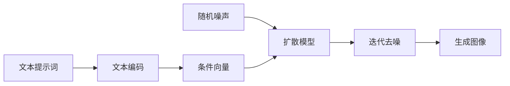

# 图像生成服务与结果

[项目说明](../../../../README.md) · [当前模块说明](../../README.md)

图像生成由独立 Flask 服务处理，工作台通过 `DiffusionService` 调用。模型按需加载，配置包括提示词及生成参数；生成结果与历史通过服务接口返回。

默认服务位于本机 5001 端口。页面可用与模型已加载是两个状态，首次加载还涉及权重、设备和依赖。

## 怎样验证

1. 先检查服务健康状态，再执行加载模型。
2. 记录提示词和生成参数，检查服务返回的图片与信息。
3. 确认生成历史和文件可以读取，并在失败时查看原服务日志。

## 使用边界

固定种子、输出质量、显存和耗时的可复现性取决于具体模型、设备和依赖版本；旧示例图片不是当前任务的生成证据。

## 实现入口

- [src/search_engine/diffusion_service.py](../../../../src/search_engine/diffusion_service.py)
- [image_generation_service.py](../../../../image_generation_service.py)
- [src/search_engine/image_tab/image_tab.py](../../../../src/search_engine/image_tab/image_tab.py)

## 代码与图解参考

下列内容保留原有讲义中的代码、图解和输入输出示例。它们用于理解设计，可能省略初始化、依赖或使用旧接口；当前调用方式以本页“实现入口”链接的源码为准。示例中的指标、耗时和结果不作为本项目的验收数据。

<details>
<summary>展开代码与图解示例</summary>

### 示例 1



### 示例 2

```bash
./quick_start.sh
```

### 示例 3

```python
from src.search_engine.diffusion_service import DiffusionService

diffusion_service = DiffusionService(output_dir="models/generated_images")
success, message = diffusion_service.load_model("sdxl-turbo")
print(message)

result = diffusion_service.generate_image(
    prompt="一只可爱的橘猫在窗边晒太阳",
    negative_prompt="模糊, 低清晰度, 水印",
    num_inference_steps=4,
    guidance_scale=0.0,
    width=512,
    height=512,
    seed=-1,
    num_images=1
)
```

</details>
