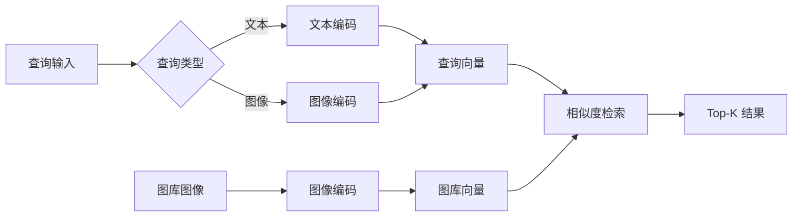

# 图片入库与跨模态检索

[项目说明](../../../../README.md) · [当前模块说明](../../README.md)

图片检索把图片与文本编码到可比较的表示中，再从图片库返回相似结果。当前由 `ImageService` 保存图片、元数据与嵌入索引，CLIP 模型在实际编码时按需加载。

上传、图搜图、文搜图与图片管理是不同入口。上传成功只表示文件已交给服务，仍需核对编码、入库与检索结果。

## 怎样验证

1. 加入一张已知图片，核对返回的图片 ID、描述、标签和统计。
2. 用原图执行图搜图，再用描述执行文搜图，比较结果与元数据。
3. 重启服务后核对索引和文件是否按原路径读取。

## 使用边界

相似度不等于业务相关性。更换编码模型后，旧嵌入能否继续使用需要重新核对；界面迁移没有自动重建全部向量。

## 实现入口

- [src/search_engine/image_service.py](../../../../src/search_engine/image_service.py)
- [src/search_engine/image_tab/image_tab.py](../../../../src/search_engine/image_tab/image_tab.py)

## 代码与图解参考

下列内容保留原有讲义中的代码、图解和输入输出示例。它们用于理解设计，可能省略初始化、依赖或使用旧接口；当前调用方式以本页“实现入口”链接的源码为准。示例中的指标、耗时和结果不作为本项目的验收数据。

<details>
<summary>展开代码与图解示例</summary>

### 示例 1



### 示例 2

```python
class ImageSearch:
    """基于向量相似度的图像检索"""

    def search_by_text(self, query: str, top_k: int = 10):
        query_vector = self.encoder.encode_text(query)
        similarities = cosine_similarity(
            query_vector.reshape(1, -1),
            np.array(self.image_vectors)
        )[0]
        top_indices = np.argsort(similarities)[::-1][:top_k]
        return [self.image_metadata[i] for i in top_indices]
```

</details>
