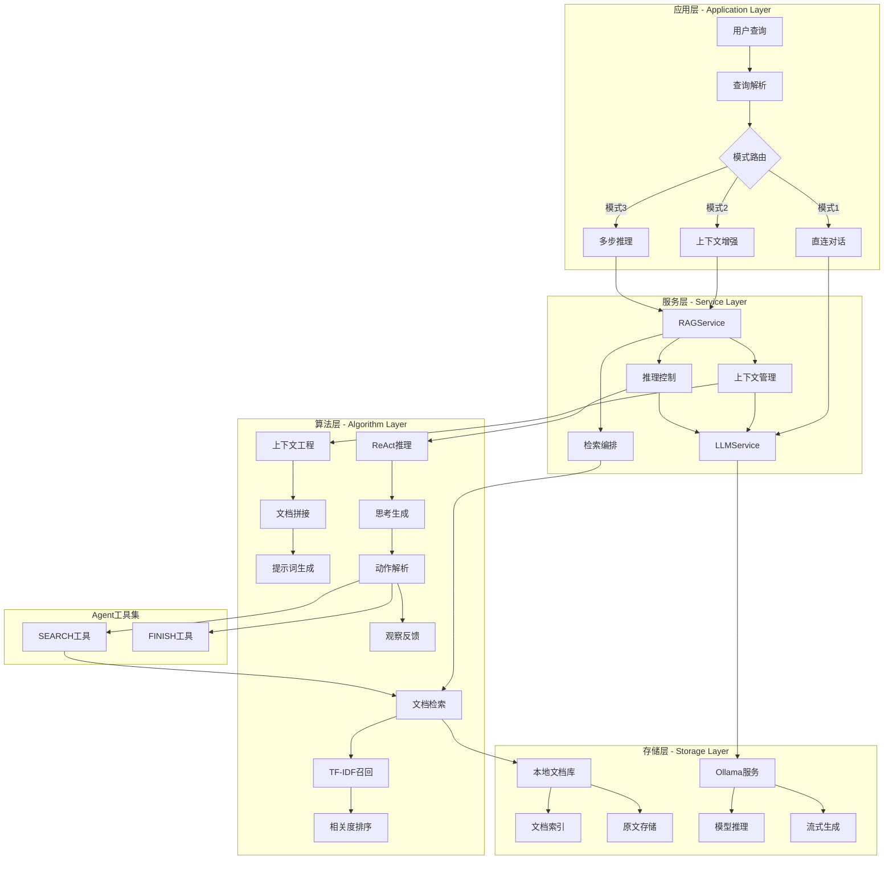

# RAG 与图谱推理：代码与图解参考

[当前模块说明](../README.md) · [项目说明](../../../README.md)

原指南重复维护的启动步骤、能力列表和固定性能数字已经移出主说明。使用当前工作台时，先按模块 README 完成操作；需要理解旧设计时再展开下方示例。

## 当前实现入口

- [src/search_engine/rag_tab/rag_tab.py](../../../src/search_engine/rag_tab/rag_tab.py)
- [src/search_engine/rag_tab/rag_service.py](../../../src/search_engine/rag_tab/rag_service.py)
- [src/search_engine/training_tab/inference_model.py](../../../src/search_engine/training_tab/inference_model.py)

## 代码与图解参考

下列内容保留原有讲义中的代码、图解和输入输出示例。它们用于理解设计，可能省略初始化、依赖或使用旧接口；当前调用方式以本页“实现入口”链接的源码为准。示例中的指标、耗时和结果不作为本项目的验收数据。

<details>
<summary>展开代码与图解示例</summary>

### 示例 1



### 示例 2

```python
# 文件: src/search_engine/rag_tab/rag_service.py
class RAGService:
    """RAG服务引擎 - 三阶段处理pipeline"""
    
    def __init__(self, index_service, ollama_url: str = "http://localhost:11434"):
        # 依赖注入 - 复用现有检索能力
        self.index_service = index_service
        self.ollama_url = ollama_url
        self.default_model = "llama3.1:8b"
        
        # 提示词模板 - 结构化prompt设计
        self.context_template = self._load_prompt_templates()
    
    def rag_query(self, query: str, model: str = None, top_k: int = 5) -> RAGResponse:
        """RAG查询主流程"""
        # Stage 1: 检索相关文档
        relevant_docs = self.retrieve_documents(query, top_k)
        
        # Stage 2: 上下文增强
        enhanced_prompt = self.enhance_with_context(query, relevant_docs)
        
        # Stage 3: LLM生成
        response = self.generate_answer(enhanced_prompt, model)
        
        return RAGResponse(
            answer=response,
            retrieved_docs=relevant_docs,
            prompt_used=enhanced_prompt
        )
    
    def retrieve_documents(self, query: str, top_k: int = 5) -> List[Document]:
        """检索阶段 - 复用倒排索引"""
        # 调用现有IndexService，避免重复实现
        raw_results = self.index_service.search(query, top_k)
        
        # 结果结构化
        documents = []
        for doc_id, score, content in raw_results:
            documents.append(Document(
                id=doc_id,
                content=content,
                relevance_score=score
            ))
        
        return documents
    
    def enhance_with_context(self, query: str, documents: List[Document]) -> str:
        """增强阶段 - 上下文工程"""
        # 文档内容拼接
        context = "\n\n".join([
            f"文档{i+1}: {doc.content}" 
            for i, doc in enumerate(documents)
        ])
        
        # 应用提示词模板
        enhanced_prompt = self.context_template.format(
            context=context,
            query=query
        )
        
        return enhanced_prompt
```

### 示例 3

```python
CONTEXT_PROMPT_TEMPLATE = """基于以下上下文信息，回答用户的问题。如果上下文中没有相关信息，请说明无法根据提供的信息回答。

上下文信息：
{context}

用户问题：{query}

请用中文回答："""
```

### 示例 4

```python
REACT_PROMPT_TEMPLATE = """你是一个智能助手，可以使用以下工具来回答问题：

工具：
- SEARCH(query): 搜索相关文档
- FINISH(answer): 给出最终答案

请使用以下格式：
Thought: 思考下一步应该做什么
Action: SEARCH(具体查询) 或 FINISH(最终答案)
Observation: 工具返回的结果

问题：{query}

开始推理："""
```

### 示例 5

```python
def check_ollama_connection(self) -> Tuple[bool, str]:
    try:
        response = requests.get(f"{self.ollama_url}/api/tags", timeout=5)
        if response.status_code == 200:
            models = response.json().get("models", [])
            return True, f"✅ 可用模型: {[m['name'] for m in models]}"
    except requests.exceptions.RequestException as e:
        return False, f"❌ 连接失败: {str(e)}"
```

### 示例 6

```python
def generate_stream(self, prompt: str, model: str):
    response = requests.post(
        f"{self.ollama_url}/api/generate",
        json={"model": model, "prompt": prompt, "stream": True},
        stream=True
    )
    for line in response.iter_lines():
        if line:
            yield json.loads(line)["response"]
```

### 示例 7

```
src/search_engine/
├── rag_tab/                        # RAG功能模块
│   ├── __init__.py                # 模块初始化
│   ├── rag_service.py             # RAG服务核心实现★
│   └── rag_tab.py                 # UI界面和交互逻辑
├── index_tab/                      # 检索模块（RAG依赖）
│   ├── index_service.py           # 索引服务
│   └── offline_index.py           # TF-IDF检索实现
├── data_service.py                 # 数据服务★
├── portal.py                       # 主入口和界面编排
└── service_manager.py              # 服务管理器

data/                               # 数据存储目录
├── preloaded_documents.json       # 预加载知识库文档
└── openkg_triples.tsv             # 知识图谱数据

logs/                               # 日志目录
└── rag_query_logs.json            # RAG查询日志
```

### 示例 8

```python
# RAG服务主入口 - src/search_engine/rag_tab/rag_service.py
def rag_query(query: str, model: Optional[str] = None, max_docs: int = 3) -> str:
    """
    RAG查询完整流程：检索 → 增强 → 生成
    
    Args:
        query: 用户查询
        model: LLM模型名称  
        max_docs: 最大检索文档数
    
    Returns:
        str: 生成的回答
    """

def retrieve_documents(query: str, max_docs: int = 3) -> List[Dict[str, Any]]:
    """
    文档检索核心逻辑
    
    Args:
        query: 检索查询
        max_docs: 最大返回文档数
    
    Returns:
        List[Dict]: 检索到的文档列表，包含id、content、score
    """

def generate_answer(query: str, context: str, model: Optional[str] = None) -> str:
    """
    使用Ollama生成回答
    
    Args:
        query: 用户查询
        context: 检索到的上下文
        model: 使用的模型名称
        
    Returns:
        str: 生成的回答
    """

# RAG界面入口 - src/search_engine/rag_tab/rag_tab.py
def build_rag_tab(rag_service) -> None:
    """
    构建RAG界面
    
    Args:
        rag_service: RAGService实例
    """
```

### 示例 9

```python
# 文件路径: src/search_engine/rag_tab/rag_service.py

# RAG模式提示词模板
CONTEXT_PROMPT_TEMPLATE = """基于以下上下文信息，回答用户的问题。如果上下文中没有相关信息，请说明无法根据提供的信息回答。

上下文信息：
{context}

用户问题：{query}

请用中文回答："""

# ReAct模式提示词模板  
REACT_PROMPT_TEMPLATE = """你是一个能够使用工具的AI助手。你可以通过以下步骤解决问题：

1. 思考(Thought): 分析问题需要什么信息
2. 行动(Action): 使用可用工具搜索信息
3. 观察(Observation): 查看工具返回的结果
4. 重复上述步骤直到有足够信息
5. 最终回答(Final Answer): 基于收集的信息给出答案

可用工具：
- SEARCH: 搜索相关文档，用法：SEARCH["搜索词"]

问题：{query}

让我们开始：

Thought: """
```

### 示例 10

```python
# Ollama服务配置
OLLAMA_CONFIG = {
    "url": "http://localhost:11434",       # Ollama服务地址
    "default_model": "llama3.2",          # 默认模型
    "timeout": 30,                        # 请求超时时间
    "generation_options": {               # 生成参数
        "temperature": 0.7,               # 随机性控制
        "top_p": 0.9,                     # 核心采样
        "top_k": 40,                      # Top-K采样
        "repeat_penalty": 1.1             # 重复惩罚
    }
}

# 支持的模型列表
SUPPORTED_MODELS = [
    "llama3.2",                           # 轻量级模型
    "llama3.1:8b",                        # 中等规模模型
    "qwen2.5",                            # 中文优化模型
    "deepseek-coder",                     # 代码专用模型
    "mistral"                             # 多语言模型
]
```

### 示例 11

```
基于以下上下文信息，回答用户的问题。如果上下文中没有相关信息，请说明无法根据提供的信息回答。

上下文信息：
{context}

用户问题：{query}

请用中文回答：
```

</details>
