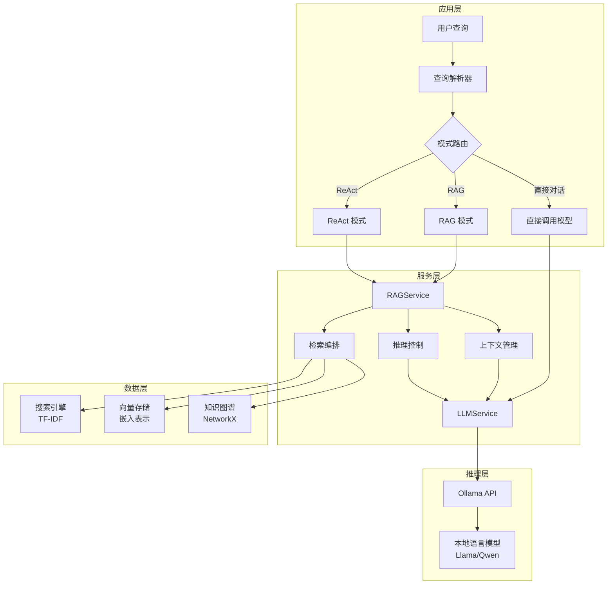

# RAG 与 OAG 的当前架构

[项目说明](../../../../README.md) · [当前模块说明](../../README.md)

RAG 和 OAG 共用页面构造器，但通过 `page_mode` 固定不同的检索链路。RAG 走词法文档检索；OAG 走图谱实体与关系查询，并可以逐步返回 ReAct 图谱推理状态。

页面提供 DashScope API 与本地模型两种推理方式。本地模型加载走训练模块的推理封装。服务中仍保留 Ollama 检查和旧推理方法，但它们不是当前默认在线问答入口。

## 怎样验证

1. 分别打开 RAG 与 OAG，核对显示的参数：文档数量与图谱游走深度不是同一含义。
2. 在线模式配置 DashScope 密钥，本地模式先完成模型加载。
3. 分别查看上下文、实际提示词、回答和图谱事实，确认依据来源。

## 使用边界

统一界面不意味着两条链路都使用同一种检索库。旧讲义中的“三种模式同页切换”和 Ollama 模型下拉框不能作为当前操作说明。

## 实现入口

- [src/search_engine/rag_tab/rag_tab.py](../../../../src/search_engine/rag_tab/rag_tab.py)
- [src/search_engine/rag_tab/rag_service.py](../../../../src/search_engine/rag_tab/rag_service.py)
- [src/search_engine/training_tab/inference_model.py](../../../../src/search_engine/training_tab/inference_model.py)

## 代码与图解参考

下列内容保留原有讲义中的代码、图解和输入输出示例。它们用于理解设计，可能省略初始化、依赖或使用旧接口；当前调用方式以本页“实现入口”链接的源码为准。示例中的指标、耗时和结果不作为本项目的验收数据。

<details>
<summary>展开代码与图解示例</summary>

### 示例 1



### 示例 2

```python
class RAGService:
    def retrieve_context(self, query: str, top_k: int = 5)
    def rerank_results(self, query: str, results: List)
    def answer_with_context(self, query: str, mode: str)
```

### 示例 3

```python
final_score = α × keyword_score + β × semantic_score + γ × graph_score
```

### 示例 4：上下文结构

```text
系统：你是一个有帮助的助手。请根据以下上下文回答问题。

上下文：
[检索到的前三段材料]

用户：{query}
```

</details>
