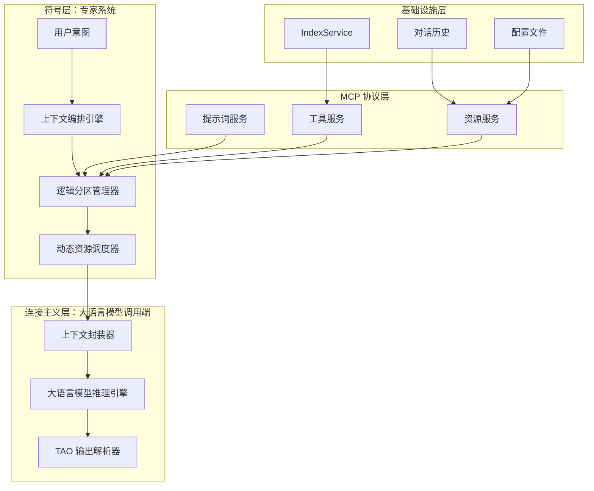
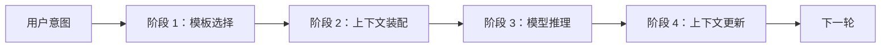
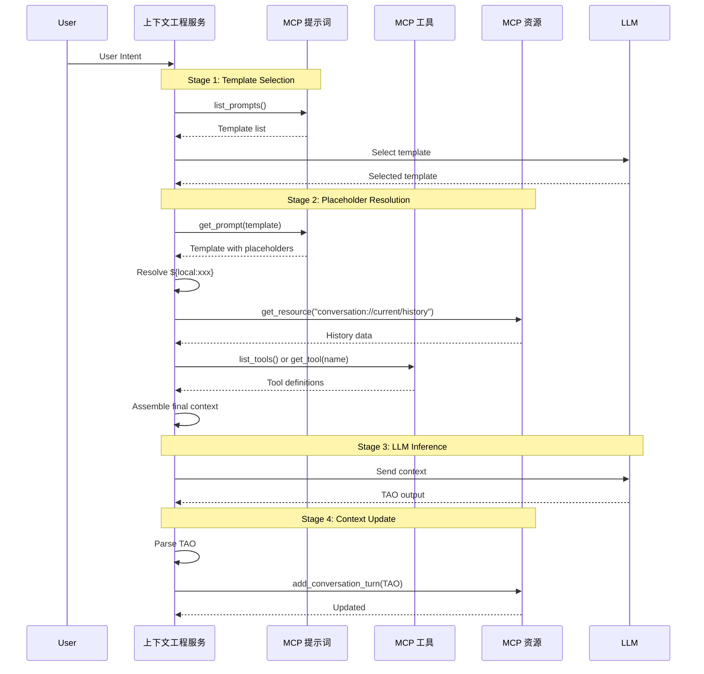

# MCP 模板、资源与工具

[项目说明](../../../../README.md) · [当前模块说明](../../README.md)

MCP 服务提供提示词模板、工具与资源；客户端负责发现、读取并调用这些能力。上下文管道根据用户意图选择模板，再解析本地值、资源和工具占位符。

`PipelineState` 在阶段间传递模板、装配后上下文、模型响应与历史更新状态；`PlaceholderResolver` 处理 `${local:...}`、`${mcp:resource:...}` 和 `${mcp:tool:...}`。实际占位符名称、工具定义和资源 URI 以当前服务为准。

## 怎样验证

1. 列取模板、工具与资源，核对服务实际暴露的名称与参数。
2. 比较替换前模板和装配后的上下文，定位未解析项。
3. 检查模型结果与历史更新是否对应同一次执行。

## 使用边界

MCP 是能力交互方式，不能仅凭使用 MCP 推断已经具备租户隔离、来源权限治理或任意外部连接器。

## 实现入口

- [src/search_engine/mcp_tab/context_pipeline.py](../../../../src/search_engine/mcp_tab/context_pipeline.py)
- [src/search_engine/mcp/dynamic_mcp_server.py](../../../../src/search_engine/mcp/dynamic_mcp_server.py)
- [src/search_engine/mcp/mcp_client_manager.py](../../../../src/search_engine/mcp/mcp_client_manager.py)

## 代码与图解参考

下列内容保留原有讲义中的代码、图解和输入输出示例。它们用于理解设计，可能省略初始化、依赖或使用旧接口；当前调用方式以本页“实现入口”链接的源码为准。示例中的指标、耗时和结果不作为本项目的验收数据。

<details>
<summary>展开代码与图解示例</summary>

### 示例 1



### 示例 2



### 示例 3

```
**Reasoning（推理）**：<对问题的详细分析>
**Action（行动）**：<工具调用或最终回答>
**Observation（观察）**：<工具执行结果或观察信息>
```

### 示例 4



### 示例 5

```python
class MCPClientManager:
    """MCP Client Manager - FastMCP implementation"""

    async def list_prompts(self) -> List[Dict[str, Any]]:
        """List all available prompts"""
        client = self.get_client("unified_server")
        prompts_dict = await client.get_prompts()
        return [{"name": name, "description": prompt.description}
                for name, prompt in prompts_dict.items()]

    def get_prompt(self, server_name: str, prompt_name: str,
                   arguments: Dict[str, Any] = None) -> str:
        """Get MCP prompt template"""
        client = self.get_client(server_name)
        return client.get_prompt(prompt_name, arguments)

    async def list_tools(self) -> List[Dict[str, Any]]:
        """List all available tools"""
        client = self.get_client("unified_server")
        tools_dict = await client.list_tools()
        return [{"name": name, "description": tool.description}
                for name, tool in tools_dict.items()]

    async def call_tool(self, tool_name: str, arguments: Dict[str, Any]) -> Any:
        """Call MCP tool"""
        client = self.get_client("unified_server")
        return await client.call_tool(tool_name, arguments)
```

### 示例 6

```python
class DynamicMCPServer:
    """Dynamic MCP Server - Fully decoupled"""

    def __init__(self):
        self.mcp = FastMCP("dynamic-mcp-server")
        self.index_service = get_index_service()
        self.conversation_history = []
        self._register_prompts()
        self._register_tools()
        self._register_resources()

    def _register_prompts(self):
        """Register prompts via MCP protocol"""

        @self.mcp.prompt("context_engineering")
        def context_engineering_prompt(user_input: str = "") -> str:
            """Context engineering prompt with TAO mode"""
            return f"""[Persona] You are a professional context engineering expert

[Current State] Time: {{local:current_time}}
User Intent: {{local:user_intent}}
Model: {{local:model_name}}

[History] {{mcp:resource:conversation://current/history}}

[Available Tools] {{mcp:tool:dynamic_tool_selection}}

[User Question] {user_input}

[Context Engineering Mode] Answer in TAO format:
Reasoning: <Analyze the problem>
Action: <Tool call or final answer>
Observation: <Results or observations>
"""

    def _register_tools(self):
        """Register tools following FastMCP best practices"""

        @self.mcp.tool(
            name="retrieve",
            description="Intelligent document retrieval with TAO support",
            tags={"search", "retrieval", "document"}
        )
        def retrieve(
            reasoning: str = "",
            action: str = "search",
            query: str = "",
            top_k: int = 5
        ) -> Dict[str, Any]:
            """Smart document retrieval tool"""
            if action.lower() == "skip":
                return {"status": "skipped", "observation": "Retrieval skipped"}

            results = self.index_service.search(query, top_k)
            return {
                "status": "success",
                "observation": {"documents": results, "total": len(results)},
                "query": query
            }

    def _register_resources(self):
        """Register resources following FastMCP best practices"""

        @self.mcp.resource(
            uri="conversation://current/history",
            name="Current Conversation History",
            description="Real-time conversation history for context continuity"
        )
        def get_conversation_history() -> str:
            """Get conversation history resource"""
            return json.dumps(self.conversation_history, indent=2)
```

### 示例 7

  ```
  Reasoning: Need to search for MCP documents first
  Action: retrieve(query="MCP architecture", top_k=5)
  Observation: Found 3 relevant documents...
  ```

</details>
