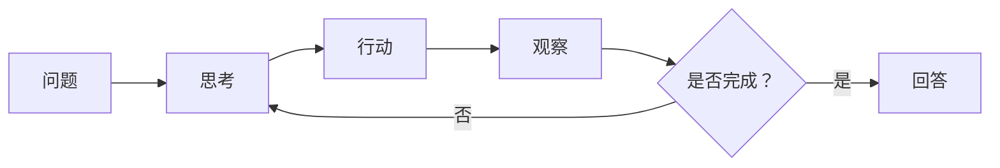

# 多步推理与图谱游走

[项目说明](../../../../README.md) · [当前模块说明](../../README.md)

多步推理把复杂问题拆解为可执行动作，根据每一步返回的观察继续组织答案。当前工作台的 OAG 页面以图谱实体和关系为主要事实来源，而不是旧示例中反复执行任意互联网搜索的通用代理。

OAG 使用图谱游走深度与每跳关系扩展上限控制信息范围；默认深度为 2、每跳上限为 4。当前在线路径传入的 ReAct 最大步骤数为 6，并将中间结果逐步更新到界面。

## 怎样验证

1. 先在知识图谱子页查到种子实体及至少一条相关关系。
2. 在 OAG 中输入相同问题，检查每步动作、观察及累计事实。
3. 改变深度与扩展上限，观察事实范围和结果变化，记录是否出现无效扩展。

## 使用边界

更深的游走不必然带来更可靠的回答。图谱缺边、实体歧义和模型动作解析失败都可能限制结果；不能把界面输出的轨迹视为模型内部过程的完整证明。

## 实现入口

- [src/search_engine/rag_tab/rag_tab.py](../../../../src/search_engine/rag_tab/rag_tab.py)
- [src/search_engine/rag_tab/rag_service.py](../../../../src/search_engine/rag_tab/rag_service.py)
- [src/search_engine/index_tab/kg_retrieval_service.py](../../../../src/search_engine/index_tab/kg_retrieval_service.py)

## 代码与图解参考

下列内容保留原有讲义中的代码、图解和输入输出示例。它们用于理解设计，可能省略初始化、依赖或使用旧接口；当前调用方式以本页“实现入口”链接的源码为准。示例中的指标、耗时和结果不作为本项目的验收数据。

<details>
<summary>展开代码与图解示例</summary>

### 示例 1



### 示例 2

```
Thought 1（思考）：我需要查找 Python 用于网页开发的信息。
Action 1（行动）：SEARCH["Python 网页开发"]
Observation 1（观察）：找到 3 篇有关 Django、Flask 等框架的文档。

Thought 2（思考）：接下来需要查找 Java 网页开发的信息。
Action 2（行动）：SEARCH["Java 网页开发"]
Observation 2（观察）：找到 3 篇有关 Spring、Jakarta EE 等框架的文档。

Thought 3（思考）：信息已经足够，可以进行比较。
Action 3（行动）：FINISH["Python 借助 Django、Flask 等框架支持快速开发，
语法简洁、库丰富。Java 借助 Spring、Jakarta EE 提供企业级方案，
具备强类型以及规模化场景下的性能优势……"]
```

### 示例 3

```python
REACT_CONFIG = {
    "max_iterations": 5,        # Max reasoning steps
    "top_k_per_search": 3,      # Documents per SEARCH
    "max_context_length": 2000, # Total context limit
    "temperature": 0.0          # Deterministic reasoning
}
```

</details>
