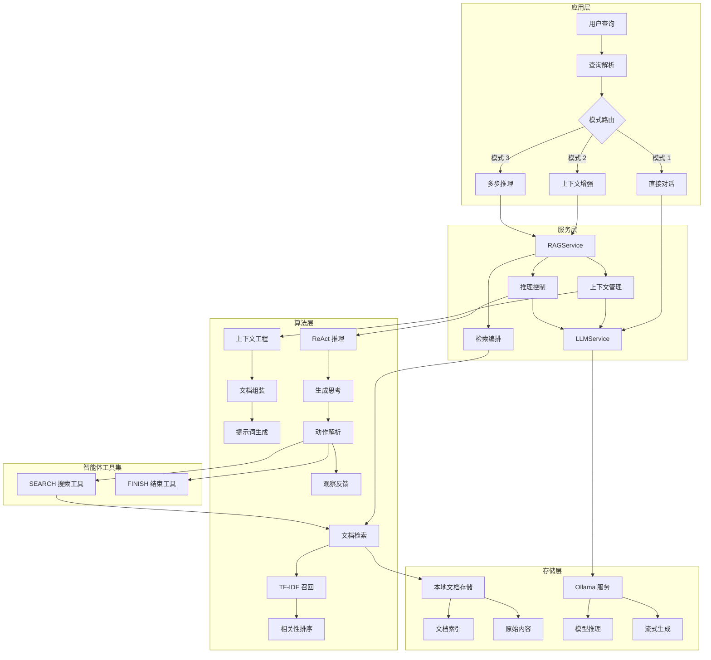

# RAG 与 OAG 阅读路径

[项目说明](../../../../README.md) · [当前模块说明](../../README.md)

该模块的安装和当前操作步骤统一维护在模块 README，本页用于连接原讲义中的图解和代码。先读模块主说明，完成一次最小操作，再按具体问题进入专题，避免在多份总览中重复维护参数与启动命令。

## 怎样验证

1. 确认输入材料、所选模型或服务已经就绪。
2. 执行一个能观察到实际结果的小任务，保留输入和输出。
3. 对照真实源码与运行结果判断能力，不使用概念图中的组件推断已部署功能。

## 使用边界

下面的原有示例可能包含旧版路径、模拟输出或未实现的扩展设计；当前操作只以模块 README 和源码为准。

## 实现入口

- [src/search_engine/rag_tab/rag_tab.py](../../../../src/search_engine/rag_tab/rag_tab.py)
- [src/search_engine/rag_tab/rag_service.py](../../../../src/search_engine/rag_tab/rag_service.py)

## 代码与图解参考

下列内容保留原有讲义中的代码、图解和输入输出示例。它们用于理解设计，可能省略初始化、依赖或使用旧接口；当前调用方式以本页“实现入口”链接的源码为准。示例中的指标、耗时和结果不作为本项目的验收数据。

<details>
<summary>展开代码与图解示例</summary>

### 示例 1



### 示例 2

```
src/search_engine/
├── rag_tab/                        # RAG 功能模块
│   ├── __init__.py                # 模块初始化
│   ├── rag_service.py             # RAG 服务核心实现 ⭐
│   └── rag_tab.py                 # 界面与交互逻辑
├── index_tab/                      # 检索模块（RAG 依赖）
│   ├── index_service.py           # 索引服务
│   └── offline_index.py           # TF-IDF 检索实现
├── data_service.py                 # 数据服务 ⭐
├── portal.py                       # 主入口与界面编排
└── service_manager.py              # 服务管理器

data/                               # 数据存储目录
├── preloaded_documents.json       # 预加载知识库文档
└── openkg_triples.tsv             # 知识图谱数据

logs/                               # 日志目录
└── rag_query_logs.json            # RAG 查询日志
```

### 示例 3

```
根据以下上下文回答用户问题。
如果上下文中没有相关信息，请说明无法依据已提供的信息回答。

上下文：
{context}

用户问题：{query}

请用中文回答：
```

### 示例 4

```
你是能够使用工具的 AI 助手，可以按以下步骤解决问题：

1. Thought（思考）：分析问题需要哪些信息。
2. Action（行动）：使用可用工具查找信息。
3. Observation（观察）：查看工具返回的结果。
4. 重复上述步骤，直到获得足够的信息。
5. Final Answer（最终回答）：根据收集到的信息作答。

可用工具：
- SEARCH：检索相关文档，调用方式为 SEARCH["查询词"]。

问题：{query}

开始：

Thought（思考）：
```

### 示例 5

```python
# File: src/search_engine/rag_tab/rag_service.py
class RAGService:
    """RAG Service Engine - Three-stage processing pipeline"""

    def __init__(self, index_service, ollama_url: str = "http://localhost:11434"):
        # Dependency injection - reuse existing retrieval capabilities
        self.index_service = index_service
        self.ollama_url = ollama_url
        self.default_model = "llama3.1:8b"

        # Prompt templates - structured prompt design
        self.context_template = self._load_prompt_templates()

    def rag_query(self, query: str, model: str = None, top_k: int = 5) -> RAGResponse:
        """RAG query main workflow"""
        # Stage 1: Retrieve relevant documents
        relevant_docs = self.retrieve_documents(query, top_k)

        # Stage 2: Context enhancement
        enhanced_prompt = self.enhance_with_context(query, relevant_docs)

        # Stage 3: LLM generation
        response = self.generate_answer(enhanced_prompt, model)

        return RAGResponse(
            answer=response,
            retrieved_docs=relevant_docs,
            prompt_used=enhanced_prompt
        )
```

### 示例 6

```python
def retrieve_documents(self, query: str, top_k: int = 5) -> List[Document]:
    """Retrieval stage - reuse inverted index"""
    # Call existing IndexService to avoid reimplementation
    raw_results = self.index_service.search(query, top_k)

    # Structure results
    documents = []
    for doc_id, score, content in raw_results:
        documents.append(Document(
            id=doc_id,
            content=content,
            relevance_score=score
        ))

    return documents
```

### 示例 7

```python
def enhance_with_context(self, query: str, documents: List[Document]) -> str:
    """Enhancement stage - context engineering"""
    # Concatenate document content
    context = "\n\n".join([
        f"Document {i+1}: {doc.content}"
        for i, doc in enumerate(documents)
    ])

    # Apply prompt template
    enhanced_prompt = self.context_template.format(
        context=context,
        query=query
    )

    return enhanced_prompt
```

### 示例 8

```python
def check_ollama_connection(self) -> Tuple[bool, str]:
    try:
        response = requests.get(f"{self.ollama_url}/api/tags", timeout=5)
        if response.status_code == 200:
            models = response.json().get("models", [])
            return True, f"✅ Available models: {[m['name'] for m in models]}"
    except requests.exceptions.RequestException as e:
        return False, f"❌ Connection failed: {str(e)}"
```

### 示例 9

```python
def generate_stream(self, prompt: str, model: str):
    response = requests.post(
        f"{self.ollama_url}/api/generate",
        json={"model": model, "prompt": prompt, "stream": True},
        stream=True
    )
    for line in response.iter_lines():
        if line:
            yield json.loads(line)["response"]
```

### 示例 10

```python
OLLAMA_CONFIG = {
    "url": "http://localhost:11434",       # Ollama service address
    "default_model": "llama3.2",          # Default model
    "timeout": 30,                        # Request timeout
    "generation_options": {               # Generation parameters
        "temperature": 0.7,               # Randomness control
        "top_p": 0.9,                     # Nucleus sampling
        "top_k": 40,                      # Top-K sampling
        "repeat_penalty": 1.1             # Repetition penalty
    }
}

# Supported model list
SUPPORTED_MODELS = [
    "llama3.2",                           # Lightweight model
    "llama3.1:8b",                        # Medium-scale model
    "qwen2.5",                            # Chinese-optimized model
    "deepseek-coder",                     # Code-specific model
    "mistral"                             # Multilingual model
]
```

### 示例 11

```bash
# 1. Check if Ollama is running
curl http://localhost:11434/api/tags

# 2. Start Ollama service
ollama serve

# 3. Check firewall settings
# 4. Verify Ollama URL in configuration
```

### 示例 12

```bash
# Pull model
ollama pull llama3.1:8b

# List available models
ollama list

# Check model name format (case-sensitive)
```

</details>
