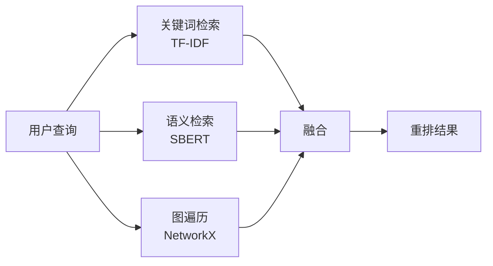

# 检索材料与回答依据

[项目说明](../../../../README.md) · [当前模块说明](../../README.md)

词法检索通过分词和倒排索引召回文档；图谱查询围绕实体与关系组织事实。两者提供的是不同形式的上下文，应先明确当前问题需要文本证据还是关系路径。

RAG 服务调用索引服务获取文档 ID、分数与内容，再构造提示词。OAG 在图服务上寻找实体、扩展关系，并把获得的事实组织为回答依据。

## 怎样验证

1. 选择一个能在原文中定位答案的问题，记录命中的文档或图谱事实。
2. 测试同义词、无命中和实体歧义，观察召回边界。
3. 分别判断检索是否命中、上下文是否完整、回答是否正确。

## 使用边界

检索分数不是回答正确率。当前默认文档路径是词法检索；向量召回、混合检索与外部搜索须有具体实现入口后才能写入能力说明。

## 实现入口

- [src/search_engine/index_tab/offline_index.py](../../../../src/search_engine/index_tab/offline_index.py)
- [src/search_engine/rag_tab/rag_service.py](../../../../src/search_engine/rag_tab/rag_service.py)
- [src/search_engine/index_tab/kg_retrieval_service.py](../../../../src/search_engine/index_tab/kg_retrieval_service.py)

## 代码与图解参考

下列内容保留原有讲义中的代码、图解和输入输出示例。它们用于理解设计，可能省略初始化、依赖或使用旧接口；当前调用方式以本页“实现入口”链接的源码为准。示例中的指标、耗时和结果不作为本项目的验收数据。

<details>
<summary>展开代码与图解示例</summary>

### 示例 1



### 示例 2

```python
from sklearn.feature_extraction.text import TfidfVectorizer

vectorizer = TfidfVectorizer(
    max_features=5000,
    stop_words='english',
    ngram_range=(1, 2)
)

# 构建索引
tfidf_matrix = vectorizer.fit_transform(documents)

# 查询
query_vec = vectorizer.transform([query])
scores = cosine_similarity(query_vec, tfidf_matrix)
```

### 示例 3

```python
from sentence_transformers import SentenceTransformer

model = SentenceTransformer('all-MiniLM-L6-v2')

# 文档向量化
doc_embeddings = model.encode(documents)

# 查询向量化
query_embedding = model.encode(query)
scores = cosine_similarity([query_embedding], doc_embeddings)
```

### 示例 4

```
(机器学习, is_a, 人工智能领域)
(神经网络, used_in, 深度学习)
(Python, used_for, 数据科学)
```

### 示例 5

```python
import networkx as nx

# 基于图结构进行查询扩展
def expand_query(entity, depth=2):
    neighbors = nx.single_source_shortest_path_length(
        kg_graph, entity, cutoff=depth
    )
    return list(neighbors.keys())

# 示例："machine learning" → ["AI", "deep learning", "neural networks"]
```

### 示例 6

```python
def reciprocal_rank_fusion(rankings, k=60):
    """将多路排序结果融合为单一路径"""
    scores = {}
    
    for ranking in rankings:
        for rank, doc_id in enumerate(ranking, 1):
            if doc_id not in scores:
                scores[doc_id] = 0
            scores[doc_id] += 1 / (k + rank)
    
    return sorted(scores.items(), key=lambda x: x[1], reverse=True)
```

### 示例 7

```python
def weighted_fusion(keyword_scores, semantic_scores, graph_scores,
                   α=0.3, β=0.5, γ=0.2):
    """按权重融合不同检索分数"""
    final_scores = {}
    
    all_docs = set(keyword_scores.keys()) | set(semantic_scores.keys()) | set(graph_scores.keys())
    
    for doc_id in all_docs:
        final_scores[doc_id] = (
            α * keyword_scores.get(doc_id, 0) +
            β * semantic_scores.get(doc_id, 0) +
            γ * graph_scores.get(doc_id, 0)
        )
    
    return sorted(final_scores.items(), key=lambda x: x[1], reverse=True)
```

### 示例 8

```python
from sentence_transformers import CrossEncoder

reranker = CrossEncoder('cross-encoder/ms-marco-MiniLM-L-6-v2')

def rerank(query, candidates, top_k=5):
    """使用 cross-encoder 对候选结果重排"""
    pairs = [[query, doc] for doc in candidates]
    scores = reranker.predict(pairs)
    
    ranked = sorted(zip(candidates, scores), key=lambda x: x[1], reverse=True)
    return [doc for doc, score in ranked[:top_k]]
```

### 示例 9

```python
def expand_query(query):
    """使用同义词和关联词扩展查询"""
    # 可使用 WordNet、知识图谱或 LLM
    expansions = [
        query,  # 原始查询
        get_synonyms(query),
        get_related_entities(query)
    ]
    return ' '.join(expansions)
```

### 示例 10

```python
def hyde_retrieval(query, llm):
    """先生成假设答案，再检索相似文档"""
    # 步骤 1：由 LLM 生成假设答案
    hypothetical_doc = llm.generate(
        f"Answer the question: {query}"
    )
    
    # 步骤 2：检索与假设答案相近的文档
    results = semantic_search(hypothetical_doc)
    
    return results
```

### 示例 11

```python
from functools import lru_cache

@lru_cache(maxsize=1000)
def retrieve_cached(query):
    """缓存高频查询"""
    return retrieve(query)
```

### 示例 12

```python
# 将大索引拆分为分片以支持并行检索
shards = split_index(documents, num_shards=4)

def parallel_search(query, shards):
    with ThreadPoolExecutor() as executor:
        futures = [executor.submit(search_shard, query, shard) for shard in shards]
        results = [f.result() for f in futures]
    return merge_results(results)
```

### 示例 13

```python
def recall_at_k(retrieved, relevant, k):
    """计算 Recall@K"""
    return len(set(retrieved[:k]) & set(relevant)) / len(relevant)

def mrr(retrieved, relevant):
    """计算 MRR"""
    for i, doc in enumerate(retrieved, 1):
        if doc in relevant:
            return 1 / i
    return 0
```

</details>
