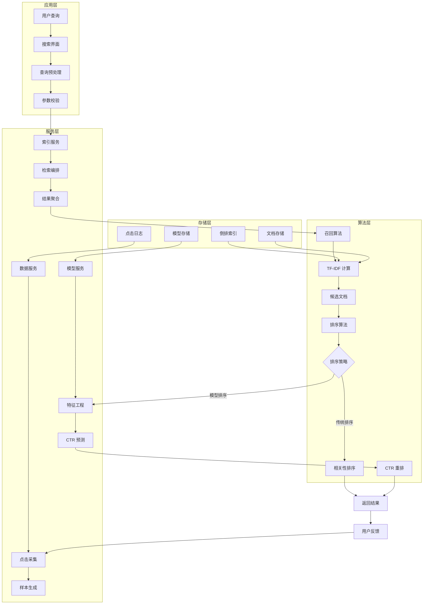
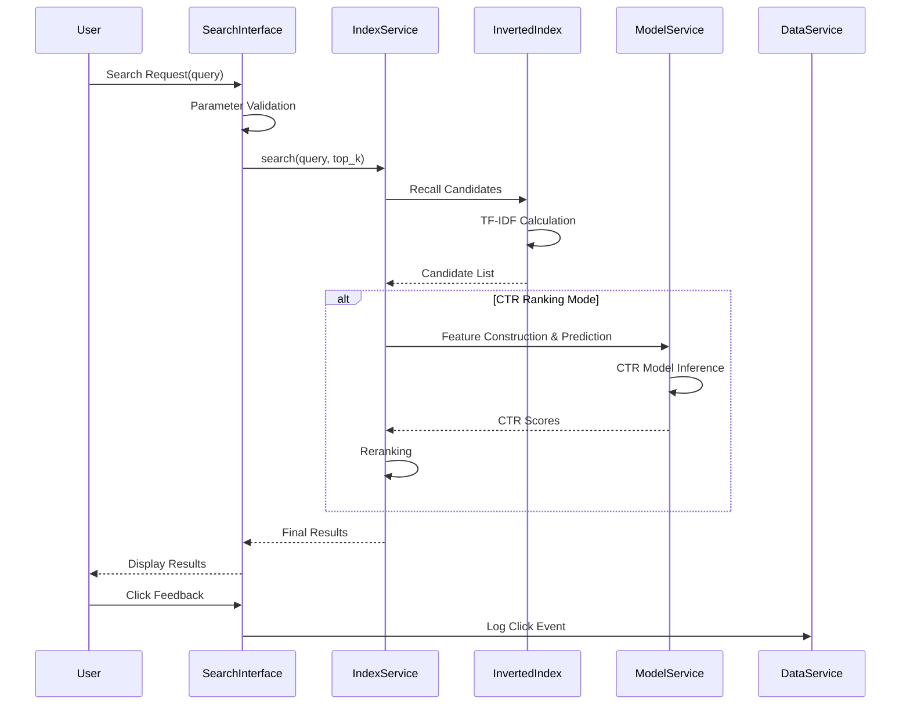
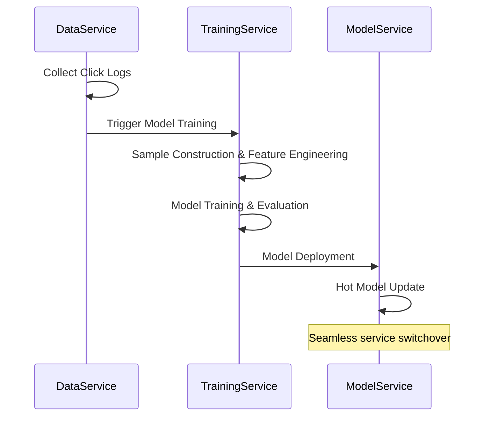

# 搜索推荐架构

[项目说明](../../../../README.md) · [当前模块说明](../../README.md)

文档索引决定哪些材料能够被召回，排序模型决定候选结果的展示顺序，点击反馈再进入训练样本。三者通过服务接口协作，应分别检查数据、模型和反馈，不能只以“页面出现结果”判断链路有效。

当前工作台由 Next.js 渲染原模块，Python 执行服务调用既有业务函数。索引服务、模型服务与数据服务仍由原服务管理器组织；界面迁移没有改成另一套检索数据库。

## 怎样验证

1. 确认索引统计中的文档数与实际文档列表相符。
2. 对同一查询比较 TF-IDF 与 CTR 排序，并记录所用模型。
3. 查看结果详情后返回列表，核对点击是否对应同一查询和文档。

## 使用边界

模块边界是代码组织方式，不等于已经部署为独立的分布式服务。吞吐量和并发能力须通过具体环境中的测量给出。

## 实现入口

- [src/search_engine/service_manager.py](../../../../src/search_engine/service_manager.py)
- [src/search_engine/index_tab/index_service.py](../../../../src/search_engine/index_tab/index_service.py)
- [src/search_engine/model_service.py](../../../../src/search_engine/model_service.py)
- [src/search_engine/data_service.py](../../../../src/search_engine/data_service.py)

## 公式参考

以下保留原有公式。变量、特征与数据分布须结合当前实现解释，公式本身不代表已经完成对应评估。

$$
\text{TF-IDF}(t, d) = \text{TF}(t, d) \times \text{IDF}(t)
$$

$$
\text{Score}(q, d) = \sum_{t \in q} \text{TF-IDF}(t, d)
$$

## 代码与图解参考

下列内容保留原有讲义中的代码、图解和输入输出示例。它们用于理解设计，可能省略初始化、依赖或使用旧接口；当前调用方式以本页“实现入口”链接的源码为准。示例中的指标、耗时和结果不作为本项目的验收数据。

<details>
<summary>展开代码与图解示例</summary>

### 示例 1



### 示例 2

```python
class InvertedIndex:
    self.index = defaultdict(set)          # term -> document ID set
    self.doc_lengths = {}                  # document ID -> length
    self.documents = {}                    # document ID -> content
    self.term_freq = defaultdict(dict)     # term -> {doc_id: frequency}
    self.doc_freq = defaultdict(int)       # term -> document frequency
```

### 示例 3



### 示例 4



### 示例 5

```python
# Index sharding strategy
def get_shard_id(term: str, shard_num: int) -> int:
    return hash(term) % shard_num

# Distributed retrieval coordination
class DistributedIndexService:
    def search(self, query: str) -> List:
        # 1. Query dispatch to all shards
        shard_results = self.query_all_shards(query)
        # 2. Merge and rerank results
        return self.merge_and_rank(shard_results)
```

### 示例 6

```python
class SearchMetrics:
    # Business Metrics
    ctr: float           # Click-through rate
    mrr: float           # Mean reciprocal rank
    ndcg_at_10: float    # Normalized discounted cumulative gain

    # System Metrics
    avg_latency: float   # Average latency
    p95_latency: float   # 95th percentile latency
    qps: float           # Queries per second

    # Data Metrics
    index_coverage: float        # Index coverage rate
    click_data_quality: float    # Click data quality score
```

</details>
