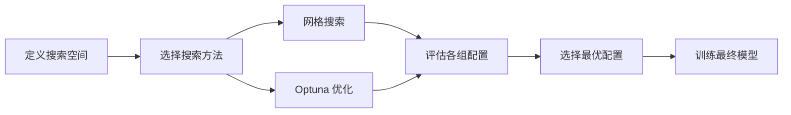

# 自动模型与超参数搜索

[项目说明](../../../../README.md) · [当前模块说明](../../README.md)

当前优化器提供网格搜索、Optuna 超参数搜索与依赖可用时的 TPOT 模型搜索。搜索方法、预算、评分指标和数据划分共同决定结果，不能简单把某一种方法视为必然最优。

使用流程是固定一份数据和评分标准，定义搜索空间，运行候选评估，再取最佳模型复核。搜索结果应同时保留参数与验证分数。

## 怎样验证

1. 用较小的搜索空间确认流程可运行，再增加预算。
2. 记录搜索方法、试验次数或代数、评价指标与最优参数。
3. 在搜索外的数据上评估最佳模型，对照默认配置。

## 使用边界

如果反复利用同一验证集选择参数，结果可能对该验证集过拟合。依赖安装成功也不代表所有模型组合在当前数据上均可训练。

## 实现入口

- [src/search_engine/training_tab/model_automl.py](../../../../src/search_engine/training_tab/model_automl.py)
- [src/search_engine/training_tab/model_evaluation.py](../../../../src/search_engine/training_tab/model_evaluation.py)

## 代码与图解参考

下列内容保留原有讲义中的代码、图解和输入输出示例。它们用于理解设计，可能省略初始化、依赖或使用旧接口；当前调用方式以本页“实现入口”链接的源码为准。示例中的指标、耗时和结果不作为本项目的验收数据。

<details>
<summary>展开代码与图解示例</summary>

### 示例 1



### 示例 2

```python
param_grid = {
    'learning_rate': [0.001, 0.01, 0.1],
    'regularization': [0.1, 1.0, 10.0],
    'batch_size': [32, 64, 128]
}
# Total combinations: 3 × 3 × 3 = 27
```

### 示例 3

```python
import optuna

def objective(trial):
    learning_rate = trial.suggest_loguniform('learning_rate', 1e-5, 1e-1)
    regularization = trial.suggest_loguniform('regularization', 0.01, 100.0)
    batch_size = trial.suggest_categorical('batch_size', [32, 64, 128, 256])
    # Optuna intelligently samples from these ranges
```

### 示例 4

```python
from sklearn.model_selection import GridSearchCV

# Define parameter grid
param_grid = {
    'learning_rate': [0.001, 0.01, 0.1],
    'regularization': [0.1, 1.0, 10.0]
}

# Create grid search
grid_search = GridSearchCV(
    estimator=model,
    param_grid=param_grid,
    cv=5,  # 5-fold cross-validation
    scoring='roc_auc',
    n_jobs=-1  # Parallel execution
)

# Fit and find best parameters
grid_search.fit(X_train, y_train)

# Best configuration
best_params = grid_search.best_params_
best_score = grid_search.best_score_
```

### 示例 5

```python
import optuna
from sklearn.model_selection import cross_val_score

def objective(trial):
    # Suggest hyperparameters
    learning_rate = trial.suggest_loguniform('learning_rate', 1e-5, 1e-1)
    regularization = trial.suggest_loguniform('regularization', 0.01, 100.0)

    # Create model with suggested parameters
    model = create_model(learning_rate=learning_rate, regularization=regularization)

    # Evaluate using cross-validation
    scores = cross_val_score(model, X_train, y_train, cv=5, scoring='roc_auc')

    # Return mean score (Optuna maximizes this)
    return scores.mean()

# Create study and optimize
study = optuna.create_study(direction='maximize')
study.optimize(objective, n_trials=100)

# Best parameters
best_params = study.best_params
best_score = study.best_value
```

</details>
