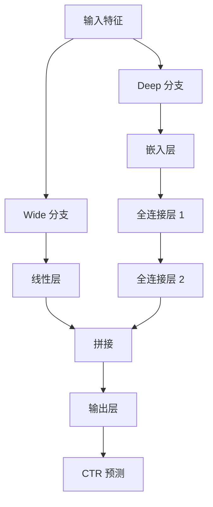
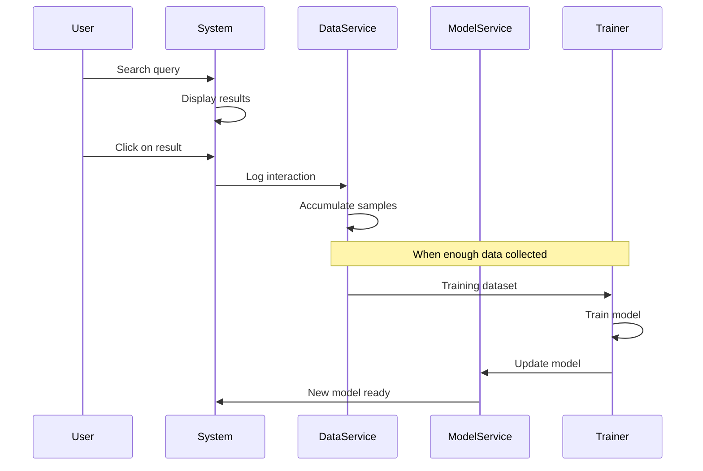

# CTR 预测与重排

[项目说明](../../../../README.md) · [当前模块说明](../../README.md)

CTR 模型使用点击样本估计候选结果的点击概率，再参与排序。当前可创建逻辑回归与 Wide & Deep 模型；两者的输入转换由各自实现负责，不应把同一份任意数组直接传给不同模型。

逻辑回归当前组合 12 项特征，包括位置、文档/查询/摘要长度、词语匹配、查询与文档历史 CTR、位置衰减、词数、时间特征和原检索分数。旧示例中的“固定 7 维”不适用于这段实现。

## 怎样验证

1. 先查看点击与未点击样本是否同时存在，再启动训练。
2. 记录数据范围、模型类型与输出路径，对照训练返回的指标。
3. 在固定查询上比较重排前后的文档顺序；模型分数不是实际点击率的直接证明。

## 使用边界

历史 CTR 和位置本身会影响特征。评估时要检查采样、特征生成与数据划分，避免把同批反馈造成的相关性误读为泛化能力。

## 实现入口

- [src/search_engine/training_tab/ctr_model.py](../../../../src/search_engine/training_tab/ctr_model.py)
- [src/search_engine/training_tab/ctr_wide_deep_model.py](../../../../src/search_engine/training_tab/ctr_wide_deep_model.py)
- [src/search_engine/model_service.py](../../../../src/search_engine/model_service.py)

## 公式参考

以下保留原有公式。变量、特征与数据分布须结合当前实现解释，公式本身不代表已经完成对应评估。

$$
P(\text{click} = 1 \mid \mathbf{x}) = \sigma(\mathbf{w}^T \mathbf{x} + b) = \frac{1}{1 + e^{-(\mathbf{w}^T \mathbf{x} + b)}}
$$

$$
\mathcal{L} = -\frac{1}{n} \sum_{i=1}^{n} \left[ y_i \log(\hat{y}_i) + (1-y_i) \log(1-\hat{y}_i) \right]
$$

$$
P(\text{click} = 1 \mid \mathbf{x}) = \sigma(y_{\text{wide}} + y_{\text{deep}})
$$

## 代码与图解参考

下列内容保留原有讲义中的代码、图解和输入输出示例。它们用于理解设计，可能省略初始化、依赖或使用旧接口；当前调用方式以本页“实现入口”链接的源码为准。示例中的指标、耗时和结果不作为本项目的验收数据。

<details>
<summary>展开代码与图解示例</summary>

### 示例 1


### 示例 2

```python
features = {
    "position": 1,              # Rank position (1, 2, 3, ...)
    "query_length": 5,           # Number of words in query
    "doc_length": 1000,          # Document length in characters
    "tfidf_score": 0.85,        # TF-IDF relevance score
    "match_ratio": 0.6,         # Query-document match ratio
    "historical_ctr": 0.12,     # Historical CTR for this doc
    "user_click_history": 0.3   # User's past click rate
}
```

### 示例 3

```python
from sklearn.linear_model import LogisticRegression

class CTRModel:
    """Logistic Regression CTR Model"""

    def __init__(self):
        self.model = LogisticRegression(
            max_iter=1000,
            solver='lbfgs',
            C=1.0  # Regularization strength
        )

    def train(self, X, y):
        """Train on feature matrix X and labels y"""
        self.model.fit(X, y)
        return self

    def predict(self, X):
        """Predict CTR probabilities"""
        return self.model.predict_proba(X)[:, 1]  # Return probability of class 1
```

### 示例 4



### 示例 5

```python
import tensorflow as tf
from tensorflow import keras

class WideAndDeepCTRModel:
    """Wide & Deep CTR Model"""

    def __init__(self, input_dim, hidden_units=[128, 64]):
        # Wide component (linear)
        wide_input = keras.Input(shape=(input_dim,), name='wide_input')
        wide_output = keras.layers.Dense(1, activation='linear')(wide_input)

        # Deep component
        deep_input = keras.Input(shape=(input_dim,), name='deep_input')
        deep = deep_input
        for units in hidden_units:
            deep = keras.layers.Dense(units, activation='relu')(deep)
            deep = keras.layers.Dropout(0.3)(deep)
        deep_output = keras.layers.Dense(1, activation='linear')(deep)

        # Combine
        combined = keras.layers.Add()([wide_output, deep_output])
        output = keras.layers.Dense(1, activation='sigmoid')(combined)

        self.model = keras.Model(
            inputs=[wide_input, deep_input],
            outputs=output
        )

        self.model.compile(
            optimizer='adam',
            loss='binary_crossentropy',
            metrics=['accuracy', 'AUC']
        )

    def train(self, X, y, epochs=10, batch_size=32):
        """Train the model"""
        self.model.fit(
            [X, X],  # Same input for wide and deep
            y,
            epochs=epochs,
            batch_size=batch_size,
            validation_split=0.2
        )
        return self

    def predict(self, X):
        """Predict CTR probabilities"""
        return self.model.predict([X, X]).flatten()
```

### 示例 6

```python
def extract_features(query, doc, position, historical_data):
    """Extract 7-dimensional feature vector"""

    features = {
        # Position feature
        "position": position,

        # Query features
        "query_length": len(query.split()),

        # Document features
        "doc_length": len(doc['content']),
        "historical_ctr": historical_data.get(doc['id'], 0.0),

        # Interaction features
        "tfidf_score": compute_tfidf(query, doc),
        "match_ratio": compute_match_ratio(query, doc),

        # User features (if available)
        "user_click_history": get_user_click_rate(user_id)
    }

    return np.array([
        features["position"],
        features["query_length"],
        features["doc_length"],
        features["tfidf_score"],
        features["match_ratio"],
        features["historical_ctr"],
        features["user_click_history"]
    ])
```

### 示例 7

```python
{
    "query": "machine learning",
    "doc_id": "doc_123",
    "position": 2,
    "features": [2, 2, 1000, 0.85, 0.6, 0.12, 0.3],
    "label": 1  # clicked
}
```

### 示例 8



### 示例 9

```python
from sklearn.metrics import accuracy_score, precision_score, recall_score, roc_auc_score

def evaluate_model(model, X_test, y_test):
    """Evaluate CTR model"""

    y_pred = model.predict(X_test)
    y_pred_binary = (y_pred > 0.5).astype(int)

    metrics = {
        "accuracy": accuracy_score(y_test, y_pred_binary),
        "precision": precision_score(y_test, y_pred_binary),
        "recall": recall_score(y_test, y_pred_binary),
        "auc": roc_auc_score(y_test, y_pred),
        "log_loss": log_loss(y_test, y_pred)
    }

    return metrics

# Example output
{
    "accuracy": 0.85,
    "precision": 0.78,
    "recall": 0.82,
    "auc": 0.88,
    "log_loss": 0.32
}
```

</details>
