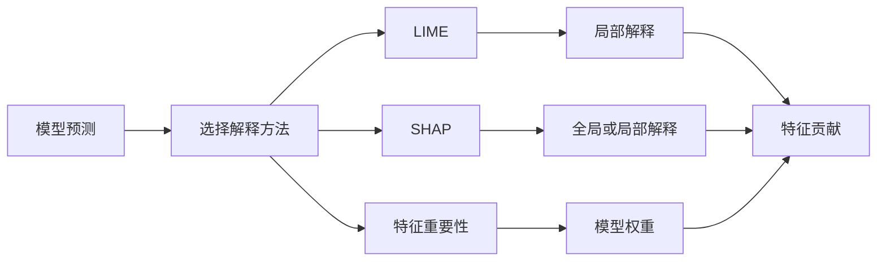

# 模型解释与特征重要性

[项目说明](../../../../README.md) · [当前模块说明](../../README.md)

解释分析回答“模型在这批输入上为何给出这些预测”，并不证明特征与点击存在因果关系。当前模块支持 LIME、SHAP 和模型自身的特征重要性。

LIME 对样本邻域进行扰动并拟合局部解释；SHAP 实现按模型能力选择解释器；模型权重等原生重要性取决于具体模型。背景数据、特征顺序和预处理必须与模型输入一致。

## 怎样验证

1. 先确认模型已训练，并核对解释使用的特征名称、顺序和数据尺度。
2. 挑选具体样本，检查预测值与解释贡献方向是否相符。
3. 对多个样本比较结果，区分局部解释与整体重要性。

## 使用边界

扰动、背景样本和解释器会影响结果；计算耗时应实际记录。解释图中的重要性不能直接作为业务规则或因果结论。

## 实现入口

- [src/search_engine/training_tab/model_interpretability.py](../../../../src/search_engine/training_tab/model_interpretability.py)
- [src/search_engine/training_tab/ctr_model.py](../../../../src/search_engine/training_tab/ctr_model.py)

## 公式参考

以下保留原有公式。变量、特征与数据分布须结合当前实现解释，公式本身不代表已经完成对应评估。

$$
\xi(x) = \underset{g \in G}{\arg\min} \mathcal{L}(f, g, \pi_x) + \Omega(g)
$$

$$
\mathcal{L}(f, g, \pi_x) = \sum_{z \in Z} \pi_x(z) \left( f(z) - g(z') \right)^2
$$

$$
\phi_i(f, x) = \sum_{S \subseteq F \setminus \{i\}} \frac{|S|! (|F| - |S| - 1)!}{|F|!} \left[ f(S \cup \{i\}) - f(S) \right]
$$

$$
f(x) = \phi_0 + \sum_{i=1}^{M} \phi_i
$$

## 代码与图解参考

下列内容保留原有讲义中的代码、图解和输入输出示例。它们用于理解设计，可能省略初始化、依赖或使用旧接口；当前调用方式以本页“实现入口”链接的源码为准。示例中的指标、耗时和结果不作为本项目的验收数据。

<details>
<summary>展开代码与图解示例</summary>

### 示例 1



### 示例 2

```python
from lime.lime_tabular import LimeTabularExplainer

# Create LIME explainer
explainer = LimeTabularExplainer(
    training_data=X_train,
    feature_names=feature_names,
    mode='classification'
)

# Explain a single prediction
explanation = explainer.explain_instance(
    data_row=X_test[0],
    predict_fn=model.predict_proba,
    num_features=10
)

# Get feature importance
feature_importance = explanation.as_list()
```

### 示例 3

```python
import shap

# Create SHAP explainer
explainer = shap.Explainer(model, X_train)

# Calculate SHAP values
shap_values = explainer(X_test[:100])  # Explain first 100 samples

# Visualize
shap.plots.bar(shap_values)  # Global feature importance
shap.plots.waterfall(shap_values[0])  # Single prediction explanation
```

### 示例 4

```python
# For Logistic Regression
feature_importance = {
    'feature_name': model.coef_[0],
    'abs_importance': np.abs(model.coef_[0])
}

# Sort by absolute importance
sorted_features = sorted(
    feature_importance.items(),
    key=lambda x: x[1]['abs_importance'],
    reverse=True
)
```

</details>
