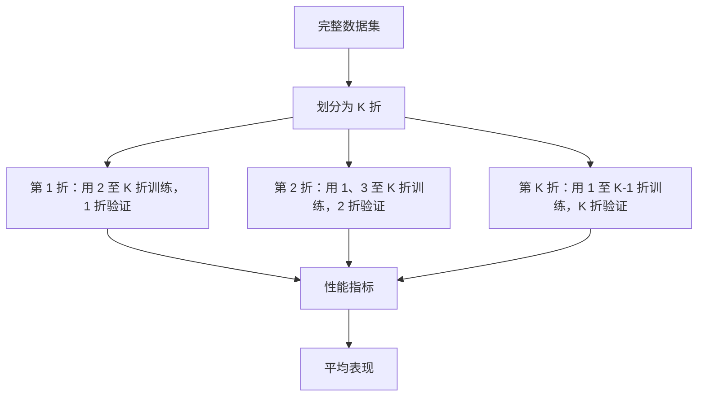

# 模型评估与交叉验证

[项目说明](../../../../README.md) · [当前模块说明](../../README.md)

交叉验证将数据分为多折，轮流训练与验证，用于观察模型在不同子集上的表现。当前评估器调用 scikit-learn 的交叉验证工具，返回各折分数、均值、标准差和部分训练/验证明细。

默认折数为 5，但有效折数还受样本量与类别分布约束。AUC 需要模型提供概率或相应评分能力，单一类别或极少样本可能无法计算。

## 怎样验证

1. 记录样本数、正负标签分布、折数与所选指标。
2. 一起看各折分数与标准差，不只看平均准确率。
3. 比较训练和验证结果，并用独立数据复核较优配置。

## 使用边界

页面中的交叉验证是实验评估入口。应另行检查特征统计是否跨越数据划分，以及相同查询、文档或时间窗口是否同时出现在训练与验证中。

## 实现入口

- [src/search_engine/training_tab/model_evaluation.py](../../../../src/search_engine/training_tab/model_evaluation.py)
- [src/search_engine/training_tab/ctr_model.py](../../../../src/search_engine/training_tab/ctr_model.py)

## 代码与图解参考

下列内容保留原有讲义中的代码、图解和输入输出示例。它们用于理解设计，可能省略初始化、依赖或使用旧接口；当前调用方式以本页“实现入口”链接的源码为准。示例中的指标、耗时和结果不作为本项目的验收数据。

<details>
<summary>展开代码与图解示例</summary>

### 示例 1



### 示例 2

```python
from sklearn.model_selection import StratifiedKFold, cross_val_score
from sklearn.metrics import make_scorer, roc_auc_score

# Create stratified k-fold splitter
skf = StratifiedKFold(n_splits=5, shuffle=True, random_state=42)

# Perform cross-validation
cv_scores = cross_val_score(
    model,
    X, y,
    cv=skf,
    scoring='roc_auc',
    n_jobs=-1
)

# Calculate statistics
mean_score = cv_scores.mean()
std_score = cv_scores.std()
```

### 示例 3

```python
from sklearn.metrics import (
    accuracy_score, precision_score, recall_score,
    f1_score, roc_auc_score
)

def evaluate_fold(y_true, y_pred, y_pred_proba):
    """Evaluate a single fold with multiple metrics"""
    return {
        'accuracy': accuracy_score(y_true, y_pred),
        'precision': precision_score(y_true, y_pred),
        'recall': recall_score(y_true, y_pred),
        'f1': f1_score(y_true, y_pred),
        'auc': roc_auc_score(y_true, y_pred_proba)
    }
```

</details>
