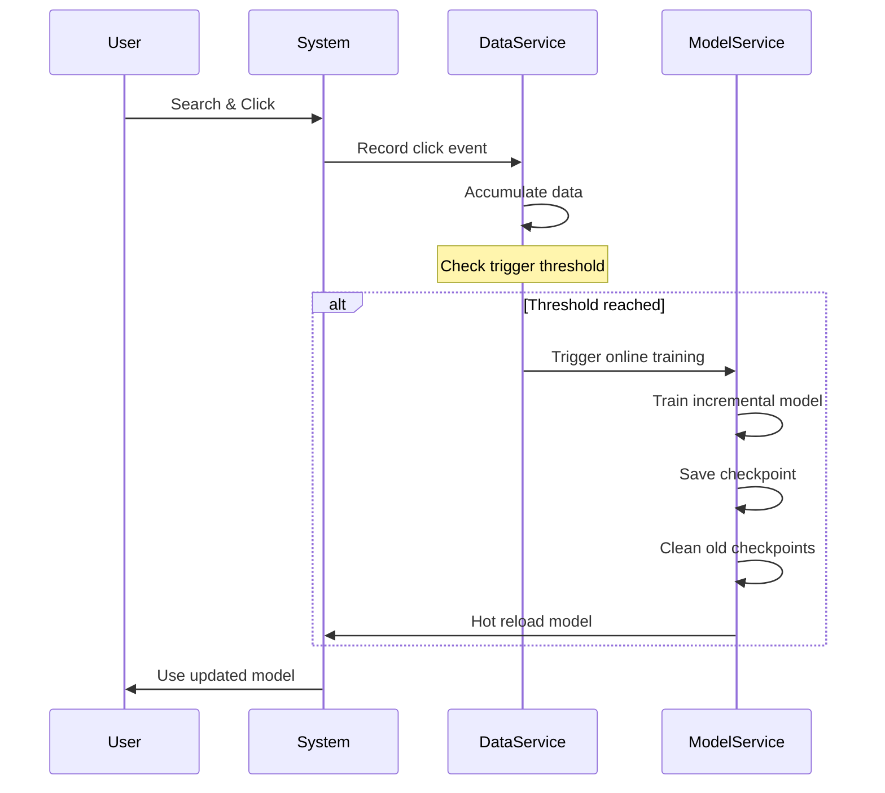

# CTR 在线学习与检查点

[项目说明](../../../../README.md) · [当前模块说明](../../README.md)

点击数据由数据服务保存，CTR 在线学习开关由模型服务管理。数据服务维护新增样本阈值，达到条件后可触发在线训练；这与大语言模型的偏好收集和 DPO 训练是两条不同流程。

模型服务区分离线与在线模型路径，并具有在线检查点编号和清理逻辑。运行中的实际开关、样本数量和输出文件决定训练是否发生。

## 怎样验证

1. 核对在线学习开关、当前样本数与新增样本阈值。
2. 查看训练日志和检查点文件，确认训练确实完成，而不是仅触发了请求。
3. 重新查询并核对实际加载的模型，保留回退所需的版本。

## 使用边界

自动触发训练不等于自动证明新模型更优，也不等于已经具备生产流量分配、灰度发布和回滚编排。

## 实现入口

- [src/search_engine/data_service.py](../../../../src/search_engine/data_service.py)
- [src/search_engine/model_service.py](../../../../src/search_engine/model_service.py)

## 代码与图解参考

下列内容保留原有讲义中的代码、图解和输入输出示例。它们用于理解设计，可能省略初始化、依赖或使用旧接口；当前调用方式以本页“实现入口”链接的源码为准。示例中的指标、耗时和结果不作为本项目的验收数据。

<details>
<summary>展开代码与图解示例</summary>

### 示例 1



### 示例 2

```python
{
    "online_learning_enabled": True,      # Enable/disable online learning
    "online_training_threshold": 100,     # Number of new samples to trigger training
    "checkpoint_retention": 5,            # Keep last N online checkpoints
    "model_prefix": "ctr_model_online"    # Online model file prefix
}
```

### 示例 3

```python
def record_click(self, query, doc_id, position, clicked):
    """Record click event and trigger online training if needed"""
    # Save click data
    sample = self._create_sample(query, doc_id, position, clicked)
    self.samples.append(sample)

    # Check online learning trigger
    if self.online_learning_enabled:
        current_count = len(self.samples)
        if current_count - self.last_training_data_count >= self.online_training_threshold:
            print(f"🔄 触发在线训练 (新增 {current_count - self.last_training_data_count} 条样本)")
            self._trigger_online_training()
```

### 示例 4

```
models/
├── ctr_offline/                    # 离线模型（手动训练）
│   ├── ctr_model_v1.pkl
│   ├── ctr_model_v2.pkl
│   └── ctr_model_v3.pkl
│
└── ctr_online/                     # 在线模型（自动训练）
    ├── ctr_model_online_001.pkl    # 最早版本
    ├── ctr_model_online_002.pkl
    ├── ctr_model_online_003.pkl
    ├── ctr_model_online_004.pkl
    └── ctr_model_online_005.pkl    # 最新版本（当前使用）
```

### 示例 5

```python
def train_model(self, model_type='logistic', is_online=False):
    """Train model with hot reloading"""
    # Train new model
    new_model = self._train(X, y)

    # Save to appropriate directory
    if is_online:
        model_path = self._save_online_checkpoint(new_model)
        self._cleanup_old_checkpoints()
    else:
        model_path = self._save_offline_model(new_model)

    # Hot reload: update active model
    self.model = new_model
    self.current_model_path = model_path

    print(f"✅ 模型已更新并自动加载: {model_path}")
```

### 示例 6

  ```
  🔄 触发在线训练 (新增 102 条样本)
  📊 开始训练 CTR 模型...
  ✅ 模型训练完成: models/ctr_online/ctr_model_online_006.pkl
  🗑️ 清理旧检查点: ctr_model_online_001.pkl
  ✅ 模型已更新并自动加载
  ```

### 示例 7

```
📊 数据统计
- 总样本数: 1,234
- 正样本数: 156 (点击)
- 负样本数: 1,078 (未点击)
- 上次训练: 1,132 样本
- 距离触发: 66 样本 (阈值: 100)
```

</details>
